# Operating_System_Mid_Exam_Notes.md

# Operating System — Midterm Examination Notes

**Subject:** Operating System
**Exam:** University Midterm Examination
**Purpose:** Conceptual Understanding, Written Preparation, and Quick Revision

---

## Table of Contents

1. [Function of an Operating System](#q1-what-is-the-function-of-an-operating-system-os)
2. [Interrupt](#q2-explain-interrupt-in-detail)
3. [Memory Organization and Memory Management](#q3-memory-organization--memory-management)
4. [Computer-System Architecture](#q4-computer-system-architecture)
5. [Multiprogramming](#q5-what-is-multiprogramming-explain-its-advantages)
6. [Multiprocessing](#q6-what-is-multiprocessing-explain-its-advantages)
7. [Multiprogramming vs Multiprocessing](#q7-differentiate-between-multiprogramming-and-multiprocessing)
8. [A Dual-Core Design](#q8-a-dual-core-design)
9. [Process Management](#q9-what-is-process-management-explain-the-activities-of-process-management)
10. [Storage Management](#q10-what-is-storage-management-explain-the-activities-of-storage-management)
11. [Kernel Data Structures](#q11-explain-kernel-data-structures-in-operating-systems)
12. [Process State](#q12-process-state)
13. [Process Control Block (PCB)](#q13-process-control-block-pcb)
14. [Multitasking](#q14-multitasking)
15. [Threads](#q15-what-is-a-thread-explain-threads-in-an-operating-system)
16. [Process Scheduling and Scheduling Queues](#q16-what-is-process-scheduling-explain-the-process-scheduling-queues)
17. [Schedulers](#q17-schedulers)
18. [Multiprocess Architecture in Google Chrome](#q18-explain-multiprocess-architecture-in-the-google-chrome-browser)
19. [Message Passing](#q19-what-is-message-passing)
20. [Synchronization](#q20-synchronization)
21. [Sockets](#q21-what-is-a-socket-explain-sockets-in-an-operating-system)
22. [Process vs Thread](#q22-differentiate-between-process-and-thread)
23. [Quick Revision Table](#quick-revision-table)
24. [Important Full Forms](#important-full-forms)
25. [Exam Tips](#exam-tips)
26. [References](#references)

---

# Q1. What Is the Function of an Operating System (OS)?

## 1. সহজ বাংলা ব্যাখ্যা

Operating System বা OS হলো এমন একটি system software, যা user/application এবং computer hardware-এর মধ্যে যোগাযোগ ও সমন্বয় করে।

আমরা যখন কোনো application চালাই, ফাইল সংরক্ষণ করি, গান শুনি অথবা ইন্টারনেট ব্যবহার করি, তখন OS প্রয়োজনীয় hardware ও software resources পরিচালনা করে।

Operating System-এর প্রধান কাজগুলো হলো:

1. **Process Management:** চলমান program বা process পরিচালনা করা।
2. **Memory Management:** RAM-এর জায়গা বরাদ্দ করা এবং ব্যবহার নিয়ন্ত্রণ করা।
3. **File-System Management:** ফাইল ও directory তৈরি, সংরক্ষণ, পড়া ও মুছে ফেলার ব্যবস্থা করা।
4. **Device Management:** Keyboard, mouse, printer, disk ইত্যাদি device পরিচালনা করা।
5. **Storage Management:** Secondary storage-এ data সংরক্ষণ ও access পরিচালনা করা।
6. **Security and Protection:** Unauthorized access থেকে system ও data রক্ষা করা।
7. **User Interface:** User-কে computer ব্যবহারের interface দেওয়া।
8. **Resource Allocation:** CPU, memory ও I/O device বিভিন্ন program-এর মধ্যে বণ্টন করা।
9. **Error Detection:** Hardware ও software-এর বিভিন্ন error শনাক্ত করতে সাহায্য করা.
10. **Accounting and Monitoring:** Resource usage পর্যবেক্ষণ ও হিসাব রাখা।

## 2. Real-Life Example

একটি বিশ্ববিদ্যালয়কে একটি computer system হিসেবে কল্পনা করো।

- University administration হলো OS।
- Teachers ও students হলো users/applications।
- Classrooms হলো memory।
- Teachers-এর সময় হলো CPU time।
- Library হলো file storage।
- Security guards হলো protection mechanisms।

Administration যেমন সবকিছুর মধ্যে সমন্বয় করে, OS-ও তেমনি computer-এর resources পরিচালনা করে।

## 3. Exam-Ready English Answer

### Definition

An Operating System (OS) is system software that acts as an intermediary between users or application programs and computer hardware. It manages hardware resources and provides an environment for executing programs efficiently and securely.

### Major Functions of an Operating System

**1. Process Management:**
The OS creates, schedules, synchronizes, and terminates processes. It also coordinates process execution and handles process-related resource allocation.

**2. Memory Management:**
It keeps track of memory usage, allocates and deallocates memory, and manages virtual memory when required.

**3. File-System Management:**
It creates, organizes, reads, writes, and deletes files and directories while managing file permissions.

**4. Device Management:**
It coordinates input/output devices through device drivers and manages I/O operations.

**5. Storage Management:**
It manages secondary storage, free-space allocation, storage allocation, and disk scheduling.

**6. Security and Protection:**
It controls access to system resources and protects data from unauthorized access.

**7. User Interface:**
It provides a command-line interface (CLI), graphical user interface (GUI), or other interfaces through which users interact with the computer.

**8. Resource Allocation:**
It distributes CPU time, memory, storage, and I/O resources among competing processes.

**9. Error Detection and Handling:**
It detects and responds to hardware and software errors to maintain system stability.

**10. Accounting and Monitoring:**
It monitors resource usage and maintains information about system activities.

### Conclusion

The operating system is essential because it makes computer hardware usable, manages system resources, and provides a convenient, efficient, and secure environment for applications.

### Diagram: User, Applications, OS, and Hardware

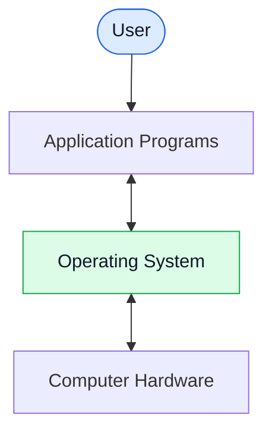

**বাংলায় Diagram:** User application ব্যবহার করে। Application প্রয়োজন অনুযায়ী OS-এর service নেয়, আর OS hardware resources পরিচালনা করে।

---

# Q2. Explain Interrupt in Detail

## 1. সহজ বাংলা ব্যাখ্যা

Interrupt হলো এমন একটি signal বা event, যার কারণে CPU সাধারণত বর্তমান instruction execution-এর স্বাভাবিক ধারার বাইরে গিয়ে কোনো বিশেষ event handle করার জন্য attention দেয়।

ধরো, CPU একটি program চালাচ্ছে। ঠিক তখন keyboard থেকে input এলো অথবা disk-এর I/O operation শেষ হলো। CPU-কে এই event সম্পর্কে জানাতে interrupt ব্যবহার করা যেতে পারে।

Interrupt handling-এর সাধারণ ধাপ:

1. কোনো device, software বা hardware event interrupt তৈরি করে।
2. CPU interrupt গ্রহণ ও পরীক্ষা করে।
3. প্রয়োজন অনুযায়ী CPU বর্তমান execution-এর state সংরক্ষণ করে।
4. CPU উপযুক্ত Interrupt Service Routine (ISR)-এ control দেয়।
5. ISR interrupt-এর কারণ অনুযায়ী কাজ করে।
6. প্রয়োজনীয় state restore করে CPU আগের execution-এ ফিরে যায়, যদি event-এর ধরন ও system-এর অবস্থা তা অনুমোদন করে।

সব interrupt একই রকম নয়। কিছু interrupt hardware থেকে আসে, কিছু software instruction দিয়ে তৈরি হয়। আবার synchronous exception ও asynchronous interrupt আলাদা বিষয়।

## 2. Real-Life Example

তুমি বই পড়ছ। হঠাৎ doorbell বাজল।

- বই পড়া: Current program।
- Doorbell: Interrupt event।
- বইয়ের পৃষ্ঠা মনে রাখা: CPU state সংরক্ষণ।
- দরজা খুলতে যাওয়া: Interrupt handler-এর কাজ।
- আবার বই পড়া: আগের execution-এ ফিরে যাওয়া।

এটি interrupt বোঝার একটি সহজ analogy।

## 3. Exam-Ready English Answer

### Definition

An interrupt is a signal or event that causes the CPU to suspend or alter its normal execution flow temporarily so that an event requiring attention can be handled.

Interrupts are important for efficient communication between the CPU, I/O devices, and software components.

### Types of Interrupts and Related Events

**1. Hardware Interrupt:**
Generated by hardware devices, such as a keyboard, timer, or network controller.

**2. Software-Generated Interrupt:**
Generated by executing a specific instruction or by a software mechanism to request a service.

**3. Maskable Interrupt:**
An interrupt that the processor or interrupt controller can temporarily disable or mask, subject to the architecture.

**4. Non-Maskable Interrupt (NMI):**
A high-priority interrupt that ordinary interrupt masking generally cannot disable. It is commonly used for critical hardware events.

**5. Exception:**
A synchronous event associated with instruction execution, such as division by zero or an invalid instruction. Exceptions are related to interrupt handling but are not identical to ordinary asynchronous hardware interrupts.

### Steps of Interrupt Handling

1. **Interrupt Generation:** A device or event requests CPU attention.
2. **Interrupt Recognition:** The processor or interrupt controller determines whether the interrupt can be handled.
3. **State Saving:** The processor saves the execution state required for correct recovery, such as the program counter and status information.
4. **ISR Selection:** The appropriate Interrupt Service Routine is identified, often through an interrupt vector or equivalent mechanism.
5. **Interrupt Service:** The handler performs the necessary work or acknowledges the event.
6. **State Restoration:** The required execution state is restored.
7. **Resumption:** The interrupted program continues when appropriate.

The exact sequence depends on the processor architecture and operating system.

### Diagram: Interrupt Handling

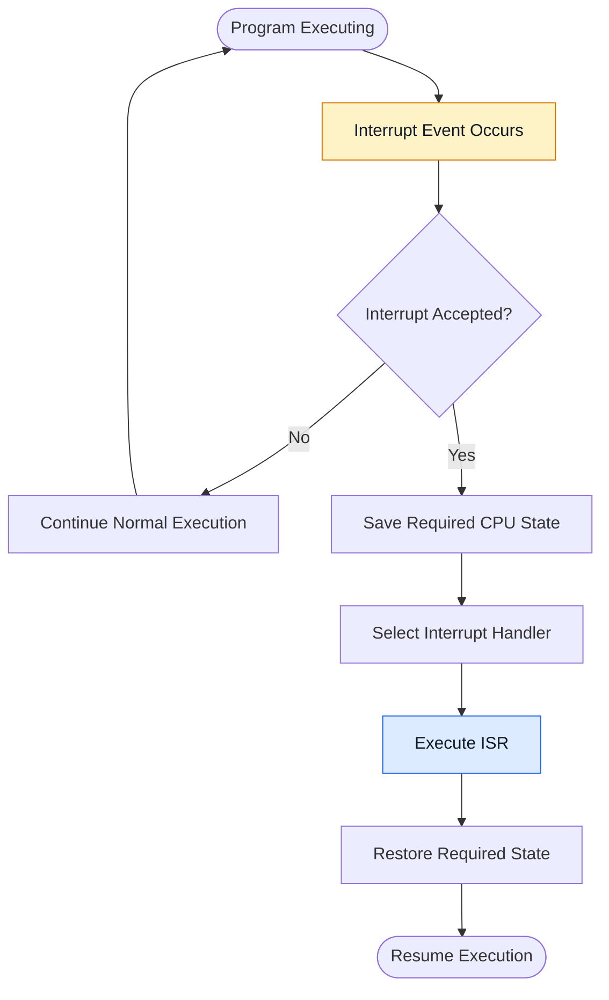

**বাংলায় Diagram:** Interrupt ঘটার পর CPU সেটি গ্রহণ করতে পারলে প্রয়োজনীয় state সংরক্ষণ করে handler চালায়। Handler-এর কাজ শেষ হলে CPU উপযুক্ত অবস্থায় আগের execution-এ ফিরে যায়।

### Advantages of Interrupts

1. Improve CPU efficiency by avoiding continuous polling in many situations.
2. Support fast response to external events.
3. Allow efficient I/O operation handling.
4. Help operating systems respond to timer events and schedule processes.
5. Support event-driven system operation.

### Conclusion

Interrupts allow the operating system and CPU to respond to important events efficiently without requiring every event to be checked continuously by the CPU.

---

# Q3. Memory Organization / Memory Management

## 1. সহজ বাংলা ব্যাখ্যা

Memory Organization বলতে computer-এর বিভিন্ন ধরনের memory কীভাবে সাজানো এবং একে অপরের সঙ্গে সম্পর্কিত, তা বোঝায়।

Memory Management হলো OS-এর সেই কাজ, যার মাধ্যমে RAM-এর জায়গা বিভিন্ন process-কে দেওয়া হয়, ব্যবহার পর্যবেক্ষণ করা হয় এবং প্রয়োজন শেষে জায়গা মুক্ত করা হয়।

### Memory Hierarchy

সাধারণভাবে memory hierarchy-তে উপরের দিকে speed বেশি এবং capacity কম থাকে। নিচের দিকে capacity বেশি হলেও access time সাধারণত বেশি হয়।

1. **Registers:** CPU-এর ভেতরে থাকা অত্যন্ত দ্রুত storage।
2. **Cache Memory:** CPU-এর কাছে থাকা দ্রুত memory।
3. **Main Memory (RAM):** চলমান program ও data-এর প্রধান working area।
4. **Secondary Storage (SSD/HDD):** দীর্ঘমেয়াদে data ও program সংরক্ষণ করে।
5. **Tertiary/Offline Storage:** Backup বা archival-এর জন্য ব্যবহৃত হতে পারে।

এখানে speed ও capacity-এর তুলনা সাধারণ ধারণা; নির্দিষ্ট hardware অনুযায়ী পার্থক্য হয়।

### OS-এর Memory Management Activities

- কোন memory area ব্যবহৃত হচ্ছে, তা track করা।
- Process-কে memory allocate করা।
- কাজ শেষ হলে memory deallocate করা।
- Process-গুলোর memory protection নিশ্চিত করা।
- Virtual memory পরিচালনা করা।
- প্রয়োজন অনুযায়ী paging বা segmentation-এর মতো mechanism ব্যবহার করা।

## 2. Real-Life Example

একটি পড়ার টেবিল কল্পনা করো।

- হাতে থাকা ছোট নোট: Registers।
- টেবিলের ওপর দরকারি বই: Cache।
- পড়ার জায়গা: RAM।
- বুকশেলফ: SSD/HDD।
- স্টোররুম: Backup storage।

সবকিছু টেবিলে রাখা যায় না। তাই প্রয়োজনীয় জিনিস সামনে রাখো, বাকিগুলো অন্য জায়গায় রাখো। Memory hierarchy-ও অনুরূপ ধারণা অনুসরণ করে।

## 3. Exam-Ready English Answer

### Definition

Memory organization refers to the arrangement and hierarchy of memory components in a computer system. Memory management is an operating system function responsible for tracking, allocating, protecting, and releasing memory used by processes.

### Memory Hierarchy

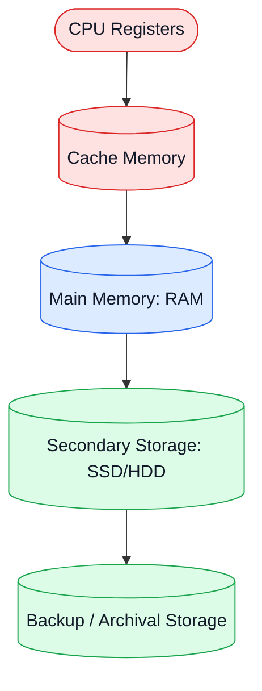

**বাংলায় Diagram:** CPU-এর সবচেয়ে কাছের registers ও cache সাধারণত দ্রুত, কিন্তু ছোট। RAM-এর capacity বেশি। SSD/HDD দীর্ঘমেয়াদি storage দেয়, কিন্তু RAM-এর তুলনায় access ধীর।

### Main Memory Management Activities

**1. Tracking Memory Usage:**
The OS maintains information about allocated and available memory regions.

**2. Memory Allocation:**
It provides memory to processes according to their requirements and the system's allocation policies.

**3. Memory Deallocation:**
It reclaims memory when processes terminate or no longer need particular allocations.

**4. Address Translation:**
With hardware support, the OS helps establish virtual-to-physical address mappings.

**5. Memory Protection:**
It prevents processes from accessing memory regions for which they do not have permission.

**6. Virtual Memory Management:**
It allows processes to operate within virtual address spaces and can keep parts of their address spaces on secondary storage when appropriate.

**7. Paging and Segmentation:**
Paging divides memory into fixed-size pages and frames. Segmentation divides a program's address space into logical units of variable sizes. Systems may use one or more memory-management techniques.

### Advantages of Memory Management

- Efficient use of physical memory.
- Isolation between processes.
- Support for multiple programs.
- Improved system stability.
- Support for virtual memory and large address spaces.

### Conclusion

Memory organization establishes the memory hierarchy, while memory management ensures that memory is allocated, protected, and used efficiently.

---

# Q4. Computer-System Architecture

## 1. সহজ বাংলা ব্যাখ্যা

Computer-System Architecture বলতে computer-এর প্রধান hardware components কীভাবে সংগঠিত এবং একসঙ্গে কাজ করে, তা বোঝায়।

প্রধান components:

- **CPU:** Instruction execute করে।
- **Main Memory:** চলমান program ও data রাখে।
- **I/O Devices:** Input ও output পরিচালনা করে।
- **Device Controllers:** নির্দিষ্ট device পরিচালনা করে।
- **System Bus/Interconnect:** Components-এর মধ্যে data ও control information আদান-প্রদান করে।
- **Operating System:** Hardware resources পরিচালনা করে।

### OS-এর দৃষ্টিতে গুরুত্বপূর্ণ architecture

**1. Single-Processor System:**
একটি প্রধান general-purpose CPU থাকে।

**2. Multiprocessor System:**
দুই বা তার বেশি processor/CPU execution resources থাকে।

**3. Multicore System:**
একটি processor chip-এর মধ্যে একাধিক CPU core থাকে।

**4. Clustered System:**
একাধিক independent computer system network-এর মাধ্যমে কাজ করতে পারে এবং কিছু ক্ষেত্রে shared storage বা failover সুবিধা দেয়।

## 2. Real-Life Example

একটি অফিস কল্পনা করো।

- CPU হলো কর্মী, যে মূল কাজ করে।
- RAM হলো কাজের টেবিল।
- Storage হলো ফাইল ক্যাবিনেট।
- I/O devices হলো printer, scanner ও keyboard।
- System bus হলো যোগাযোগের রাস্তা।
- OS হলো অফিসের resource coordinator।

## 3. Exam-Ready English Answer

### Definition

Computer-system architecture describes how a computer's processors, memory, I/O devices, controllers, and interconnection mechanisms are organized to execute programs and process data.

### Basic Computer-System Architecture

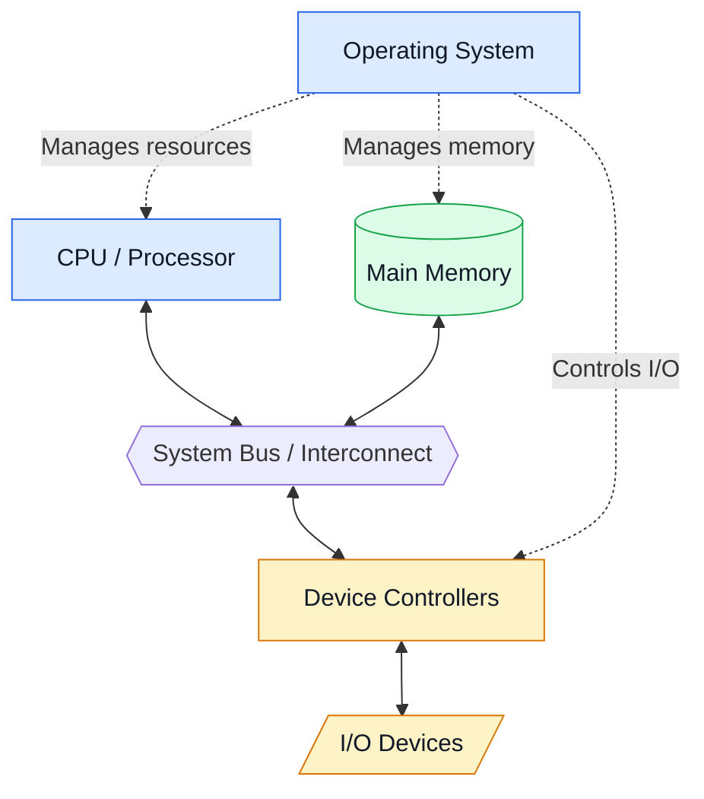

**বাংলায় Diagram:** CPU ও main memory system interconnect-এর মাধ্যমে যোগাযোগ করে। Device controller I/O device পরিচালনা করে। OS এসব resources-এর ব্যবহার সমন্বয় করে।

### Types of Computer-System Architecture

**1. Single-Processor Systems:**
These systems have one main general-purpose processor. Other specialized controllers may also exist.

**2. Multiprocessor Systems:**
These systems contain multiple processors or processing units that can execute tasks concurrently. They may share memory and other resources.

**3. Multicore Systems:**
A multicore processor contains two or more processing cores on a single chip.

**4. Clustered Systems:**
Two or more independent computers cooperate through a network. Clustered systems can provide increased availability, scalability, or performance depending on their design.

### Benefits of Multiprocessor Architecture

- Increased throughput.
- Potentially better performance.
- Improved resource sharing.
- Greater scalability.
- Improved reliability in some configurations.

### Conclusion

Computer-system architecture determines how processing, memory, storage, and I/O components cooperate. The operating system manages these resources to provide efficient execution.

---

# Q5. What Is Multiprogramming? Explain Its Advantages.

## 1. সহজ বাংলা ব্যাখ্যা

Multiprogramming হলো এমন একটি technique, যেখানে memory-তে একাধিক program রাখা হয়, যাতে একটি program I/O operation-এর জন্য অপেক্ষা করলে CPU অন্য ready program চালাতে পারে।

মূল উদ্দেশ্য হলো CPU-কে যতটা সম্ভব busy রাখা।

ধরো, Program A disk থেকে data পড়ার জন্য অপেক্ষা করছে। CPU যদি শুধু A-এর জন্য বসে থাকে, তাহলে CPU time নষ্ট হবে। Multiprogramming-এ OS তখন Program B চালাতে পারে।

**মনে রাখবে:** Multiprogramming মানেই একাধিক CPU core নয়। Single-core CPU-তেও multiprogramming করা যায়।

## 2. Real-Life Example

একজন শিক্ষক তিনজন শিক্ষার্থীকে assignment দিয়েছেন।

- Student A লিখছে।
- Student B বই খুঁজছে।
- Student C প্রশ্ন বুঝতে সময় নিচ্ছে।

শিক্ষক একজনের অপেক্ষায় বসে না থেকে অন্যজনকে সাহায্য করেন। এভাবে কাজের সময় ভালোভাবে ব্যবহার হয়।

## 3. Exam-Ready English Answer

### Definition

Multiprogramming is an operating-system technique in which multiple programs are kept in main memory so that the CPU can execute another ready program when the currently running program waits for an event, particularly an I/O operation.

### Working Principle

1. Multiple programs are loaded into memory.
2. The OS selects one ready program for execution.
3. The CPU executes its instructions.
4. If the running program waits for I/O or another event, it becomes blocked.
5. The scheduler selects another ready program.
6. When the blocked program becomes ready, it can compete for CPU time again.

### Diagram: Multiprogramming

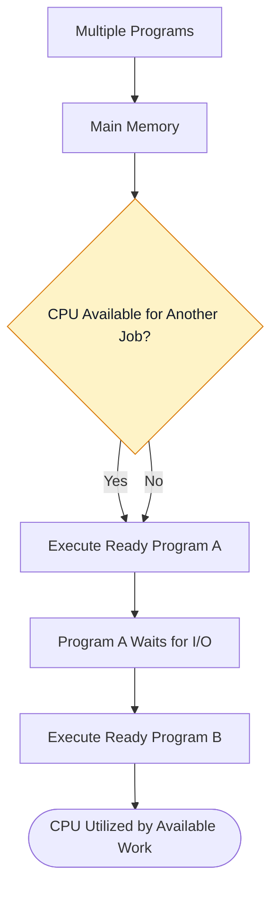

**বাংলায় Diagram:** একটি program I/O-এর জন্য block হলে OS অন্য ready program CPU-তে চালায়। ফলে CPU অপেক্ষায় থাকার বদলে অন্য কাজ করতে পারে।

### Advantages of Multiprogramming

1. **Higher CPU Utilization:** The CPU spends less time idle.
2. **Increased Throughput:** More jobs can be completed over a period.
3. **Better Resource Utilization:** CPU and I/O devices can overlap their activities.
4. **Reduced CPU Idle Time:** Another job can execute while a program waits for I/O.
5. **Improved Overall Efficiency:** System resources are used more effectively.

### Limitations

- Requires memory management.
- Needs CPU scheduling.
- Requires protection between programs.
- Can become complex when many jobs compete for resources.

### Conclusion

Multiprogramming improves CPU utilization by allowing another ready program to execute when the current program cannot continue.

---

# Q6. What Is Multiprocessing? Explain Its Advantages.

## 1. সহজ বাংলা ব্যাখ্যা

Multiprocessing হলো এমন system design, যেখানে দুই বা তার বেশি processing unit বা CPU একসঙ্গে কাজ করতে পারে।

Multiprogramming-এ একাধিক program থাকলেও single-core CPU একই সময়ে একটি instruction stream execute করে। Multiprocessing-এ একাধিক core বা processor থাকলে একাধিক task সত্যিকার অর্থে parallel execute হতে পারে।

Multiprocessing-এর সাধারণ ধরন:

- **Asymmetric Multiprocessing (AMP):** কিছু architecture-এ একটি processor control বা scheduling-এর বিশেষ দায়িত্ব নেয়, অন্য processor নির্দিষ্ট কাজ করে।
- **Symmetric Multiprocessing (SMP):** একাধিক processor/core একই OS-এর অধীনে সাধারণত shared main memory ব্যবহার করে এবং সমান ধরনের scheduling role নিতে পারে।

## 2. Real-Life Example

একটি রেস্টুরেন্টে একজন রাঁধুনি থাকলে সব খাবার একে একে তৈরি করতে হয়। চারজন রাঁধুনি থাকলে আলাদা কাজ একই সময়ে করা সম্ভব।

এখানে প্রতিটি রাঁধুনি একটি processing unit-এর মতো।

## 3. Exam-Ready English Answer

### Definition

Multiprocessing is a computer-system technique that uses two or more processing units to execute tasks concurrently and, when supported by the hardware and workload, in parallel.

### Types of Multiprocessing

**1. Symmetric Multiprocessing (SMP):**
In an SMP system, multiple processors or cores generally share main memory and are managed by a common operating system. They can execute different tasks concurrently.

**2. Asymmetric Multiprocessing (AMP):**
In an AMP system, processors may have different roles, with one processor controlling or assigning work to others. The exact design depends on the system.

### Diagram: Multiprocessing

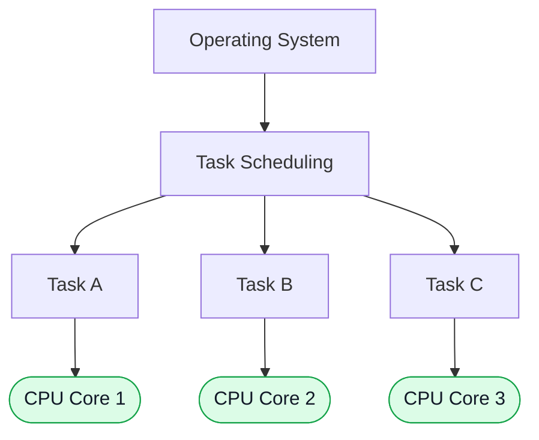

**বাংলায় Diagram:** OS বিভিন্ন task একাধিক CPU core-এ বণ্টন করে। একাধিক core থাকার কারণে independent task একই সময়ে execute হতে পারে।

### Advantages of Multiprocessing

1. **Higher Throughput:** More work can be completed in a given time.
2. **Parallel Execution:** Independent tasks can run simultaneously on different cores.
3. **Improved Performance:** Parallelizable applications can execute faster.
4. **Resource Sharing:** Processors can share memory and other system resources.
5. **Improved Reliability in Some Systems:** A system may continue operating after a processor failure if the architecture supports recovery.
6. **Better Scalability:** Additional processing resources can increase capacity, subject to system limitations.

### Limitations

- Hardware and operating-system design can be more complex.
- Synchronization is required for shared data.
- Some programs cannot be divided into parallel tasks efficiently.
- Memory bandwidth and shared-resource contention can limit performance.

### Conclusion

Multiprocessing increases computational capability by providing multiple processing units that can execute work concurrently and potentially in parallel.

---

# Q7. Differentiate Between Multiprogramming and Multiprocessing

## 1. সহজ বাংলা ব্যাখ্যা

Multiprogramming-এর মূল লক্ষ্য হলো CPU-এর idle time কমানো। একটি program অপেক্ষা করলে অন্য program চালানো হয়।

Multiprocessing-এর মূল বিষয় হলো একাধিক processing unit ব্যবহার করা, যাতে একাধিক task একই সময়ে execute হতে পারে।

অর্থাৎ, **Multiprogramming হলো program ও CPU ব্যবহারের technique; Multiprocessing হলো multiple processing units-ভিত্তিক system organization।**

## 2. Real-Life Example

- **Multiprogramming:** একজন রাঁধুনি একটি খাবার সেদ্ধ হওয়ার অপেক্ষায় অন্য খাবারের প্রস্তুতি নিচ্ছেন।
- **Multiprocessing:** কয়েকজন রাঁধুনি আলাদা খাবার একই সময়ে তৈরি করছেন।

## 3. Exam-Ready English Answer

### Differences Between Multiprogramming and Multiprocessing

| Basis | Multiprogramming | Multiprocessing |
|---|---|---|
| Definition | Keeps multiple programs in memory and switches to another when one waits. | Uses two or more processing units to execute tasks concurrently. |
| Main Objective | Increase CPU utilization. | Increase processing capability and performance. |
| CPU Requirement | Can work with a single CPU core. | Requires multiple processing units or cores for parallel execution. |
| Execution | On a single core, only one instruction stream executes at a time. | Multiple cores can execute separate instruction streams simultaneously. |
| Hardware | Does not require multiple CPU cores. | Requires multiple processing units/cores. |
| Parallelism | Does not provide true parallel CPU execution on a single core. | Can provide true parallel CPU execution. |
| Scheduling | Chooses a ready program when the CPU becomes available. | Schedules work across available processing units. |
| Complexity | Requires memory management and scheduling. | Also requires coordination across processors/cores and may need synchronization. |
| Example | A single-core computer switches to another job while one waits for I/O. | A quad-core processor runs independent tasks on different cores. |

### Conclusion

Multiprogramming improves CPU utilization by keeping useful work available, whereas multiprocessing provides multiple processing units for concurrent and potentially parallel execution.

**Exam Tip:** Write the objective, CPU requirement, execution model, and example to make the difference clear.

---

# Q8. A Dual-Core Design

## 1. সহজ বাংলা ব্যাখ্যা

Dual-core processor হলো এমন একটি processor chip, যার মধ্যে দুটি independent CPU core থাকে।

প্রতিটি core instruction execute করতে পারে। দুইটি core একই chip-এর মধ্যে থাকলেও তাদের নিজস্ব execution resources থাকে। Architecture অনুযায়ী তারা কিছু cache, memory controller বা অন্যান্য resources share করতে পারে।

Dual-core design-এর বৈশিষ্ট্য:

- দুটি processing core।
- Parallel execution-এর সুযোগ।
- Shared system memory ব্যবহার করতে পারে।
- Core-গুলোর মধ্যে cache ও resource sharing থাকতে পারে।
- OS দুইটি core-এ process বা thread schedule করতে পারে।

**মনে রাখবে:** Dual-core মানেই প্রতিটি program দ্বিগুণ দ্রুত হবে না। Performance নির্ভর করে workload, parallelism, memory bandwidth এবং software design-এর ওপর।

## 2. Real-Life Example

দুইজন কর্মীকে একটি অফিসের কাজ দেওয়া হয়েছে। একজন report তৈরি করছেন, অন্যজন data analysis করছেন। তারা একই অফিসে কাজ করছেন, কিছু resource share করছেন, কিন্তু আলাদা কাজ একসঙ্গে করছেন।

এটি dual-core-এর সহজ উদাহরণ।

## 3. Exam-Ready English Answer

### Definition

A dual-core design is a processor architecture that contains two independent processing cores on a single processor chip. Each core can execute instructions, allowing the operating system to schedule separate tasks or threads across both cores.

### Diagram: Dual-Core Design

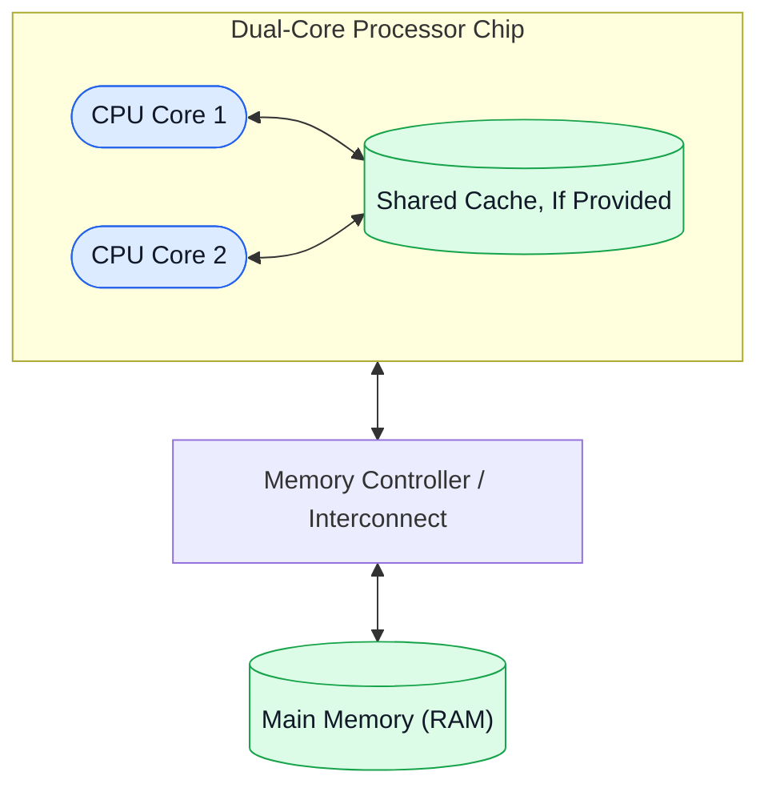

**বাংলায় Diagram:** একই processor chip-এ দুইটি core থাকে। Diagram-এ shared cache একটি সম্ভাব্য design দেখায়; সব dual-core processor-এ একই cache arrangement থাকে না। Core-গুলো memory system-এর সঙ্গে যোগাযোগ করে।

### Characteristics of Dual-Core Design

1. Contains two CPU cores on a single chip.
2. Allows separate tasks or threads to execute in parallel.
3. Can improve multitasking performance.
4. May share some cache or memory-system resources.
5. Requires operating-system support for effective scheduling.
6. Performance depends on software parallelism and resource availability.

### Advantages

- Better multitasking capability.
- Improved performance for parallel workloads.
- Potentially lower communication overhead than separate processor packages.
- More efficient use of available processing resources.

### Limitations

- Serial programs may not benefit significantly.
- Shared resources can become bottlenecks.
- Parallel programming introduces synchronization challenges.

### Conclusion

A dual-core processor provides two execution cores on one chip, enabling parallel execution and improved responsiveness when workloads can use both cores effectively.

---

# Q9. What Is Process Management? Explain the Activities of Process Management.

## 1. সহজ বাংলা ব্যাখ্যা

Process হলো একটি program-এর running instance। যেমন, কোনো browser চালালে সেটি এক বা একাধিক process তৈরি করতে পারে।

Process Management হলো OS-এর সেই অংশ, যা process তৈরি করা থেকে শুরু করে execution, scheduling, coordination এবং termination পর্যন্ত পরিচালনা করে।

প্রধান activities:

1. Process creation।
2. Process termination।
3. CPU scheduling।
4. Process state management।
5. Context switching।
6. Process synchronization।
7. Inter-process communication।
8. Deadlock handling।

## 2. Real-Life Example

একটি অফিসে অনেক কর্মী আছেন। Manager ঠিক করেন কে কোন কাজ করবেন, কার কাজ কখন শুরু হবে, কার কাজ শেষ হয়েছে এবং কার জন্য অন্য কর্মীর সাহায্য প্রয়োজন।

OS-এর process management-ও process-গুলোর execution ও coordination পরিচালনা করে।

## 3. Exam-Ready English Answer

### Definition

Process management is an operating-system function that creates, schedules, coordinates, monitors, and terminates processes while allocating the resources required for their execution.

### Activities of Process Management

**1. Process Creation:**
The OS creates processes when users or running programs request new tasks.

**2. Process Termination:**
It releases resources and removes process-related information when a process finishes or is terminated.

**3. CPU Scheduling:**
It selects a ready process or thread for CPU execution according to scheduling policies.

**4. Process-State Management:**
It maintains states such as New, Ready, Running, Waiting, and Terminated.

**5. Context Switching:**
It saves the required execution state of one process or thread and restores the state of another when switching execution.

**6. Process Synchronization:**
It coordinates concurrent processes to prevent incorrect access to shared resources.

**7. Inter-Process Communication (IPC):**
It provides mechanisms such as shared memory and message passing for processes to exchange data.

**8. Deadlock Handling:**
Depending on the system design, the OS may prevent, avoid, detect, or recover from deadlocks.

### Diagram: Process Management

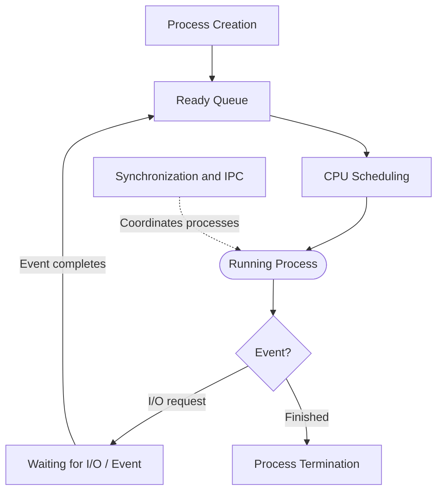

**বাংলায় Diagram:** OS process তৈরি করে ready queue-তে রাখে। Scheduler CPU-তে পাঠায়। I/O-এর প্রয়োজন হলে process অপেক্ষা করে এবং event শেষ হলে আবার ready হয়। কাজ শেষ হলে process terminate হয়।

### Importance of Process Management

- Maintains orderly process execution.
- Improves CPU utilization.
- Supports multitasking and concurrency.
- Enables communication between processes.
- Helps protect processes from improper interference.

### Conclusion

Process management is essential for coordinating program execution and sharing CPU and other resources safely and efficiently.

---

# Q10. What Is Storage Management? Explain the Activities of Storage Management.

## 1. সহজ বাংলা ব্যাখ্যা

Storage Management হলো computer-এর storage resources পরিচালনা করা, যাতে data ও program সংরক্ষণ, খুঁজে বের করা এবং প্রয়োজন অনুযায়ী ব্যবহার করা যায়।

OS storage management-এর মাধ্যমে file system, free space, storage allocation এবং disk access পরিচালনা করে।

প্রধান activities:

1. File-system management।
2. Free-space management।
3. Storage allocation।
4. Disk scheduling।
5. Directory management।
6. Storage-device management।
7. Access control ও protection।
8. Backup ও recovery-সংক্রান্ত সুবিধা, যেখানে system বা software support থাকে।

## 2. Real-Life Example

একটি library কল্পনা করো।

- বই রাখা হলো data storage।
- বইয়ের নাম ও নম্বরের তালিকা হলো directory।
- কোন shelf খালি আছে তা জানা হলো free-space management।
- বই কোন shelf-এ থাকবে তা ঠিক করা হলো storage allocation।
- পাঠক কোন বই চাইছেন তা খুঁজে দেওয়া হলো file access।

## 3. Exam-Ready English Answer

### Definition

Storage management is an operating-system function responsible for organizing, allocating, tracking, protecting, and accessing data on storage devices.

### Activities of Storage Management

**1. File-System Management:**
The OS creates, reads, writes, renames, and deletes files and directories through the file-system interface.

**2. Free-Space Management:**
It tracks unused storage blocks so that new data can be stored efficiently.

**3. Storage Allocation:**
It determines which storage blocks or regions are assigned to files and other data.

**4. Disk Scheduling:**
For storage devices and workloads where scheduling is useful, the OS or storage subsystem orders I/O requests to improve performance and responsiveness.

**5. Directory Management:**
It organizes files into directories and maintains information required to locate them.

**6. Device Management:**
It coordinates access to SSDs, HDDs, and other storage devices through the appropriate drivers and system interfaces.

**7. Protection and Access Control:**
It enforces permissions and other policies to restrict unauthorized access.

**8. Backup and Recovery Support:**
The OS and related utilities may provide facilities for backup, recovery, journaling, and consistency checking, depending on the system.

### Diagram: Storage Management

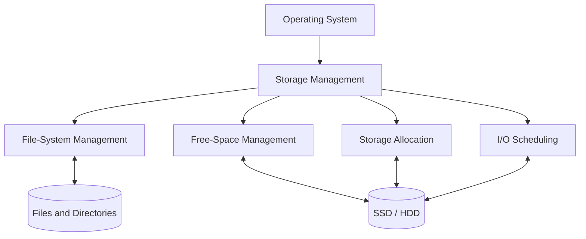

**বাংলায় Diagram:** Storage management file system, free space, allocation এবং I/O request পরিচালনা করে। এসব mechanism-এর মাধ্যমে storage device-এ data রাখা ও ব্যবহার করা হয়।

### Advantages

- Organized data storage.
- Efficient use of storage space.
- Easier file retrieval.
- Controlled access to stored data.
- Better storage reliability when supported by suitable mechanisms.

### Conclusion

Storage management helps the operating system store, locate, protect, and retrieve data efficiently from secondary storage devices.

---

# Q11. Explain Kernel Data Structures in Operating Systems.

## 1. সহজ বাংলা ব্যাখ্যা

Kernel হলো OS-এর core অংশ, যা CPU, memory, process এবং device-এর মতো গুরুত্বপূর্ণ resources পরিচালনা করে।

Kernel Data Structures হলো kernel-এর ভেতরে ব্যবহৃত data রাখার ও সংগঠিত করার structure, যার মাধ্যমে OS দ্রুত বিভিন্ন তথ্য খুঁজে পায় এবং পরিচালনা করে।

প্রধান উদাহরণ:

- **Linked List:** একাধিক element-কে link করে রাখা।
- **Queue:** FIFO বা অন্য policy অনুযায়ী item পরিচালনা করা।
- **Stack:** Last In, First Out (LIFO) পদ্ধতিতে data রাখা।
- **Tree:** Hierarchical data বা ordered data পরিচালনা করা।
- **Hash Table:** Key-এর মাধ্যমে দ্রুত lookup করা।
- **Bitmap:** Resource ব্যবহৃত নাকি free, তা bit দিয়ে track করা।
- **Process Table:** Process সম্পর্কিত তথ্য সংগঠিত করা।
- **Wait Queue:** কোনো event বা resource-এর জন্য অপেক্ষমাণ task track করা।

একটি OS সব structure সব জায়গায় ব্যবহার করে না। কাজ ও implementation অনুযায়ী structure নির্বাচন করা হয়।

## 2. Real-Life Example

একটি বিশ্ববিদ্যালয়ের database কল্পনা করো।

- Student ID দিয়ে খোঁজা: Hash table-এর মতো।
- Waiting students-এর লাইন: Queue।
- Department hierarchy: Tree।
- প্রতিটি student-এর তথ্য: Process record-এর মতো একটি record।

সঠিক data structure ব্যবহার করলে তথ্য খোঁজা ও পরিচালনা করা সহজ হয়।

## 3. Exam-Ready English Answer

### Definition

Kernel data structures are organized representations of information used by the operating-system kernel to manage processes, memory, devices, scheduling, and other system resources efficiently.

### Common Kernel Data Structures

**1. Linked Lists:**
Used to connect objects dynamically. They are useful for managing collections of kernel objects and queues.

**2. Queues:**
Used to maintain tasks or requests in an ordered collection, such as a ready queue or a device waiting queue.

**3. Stacks:**
Used for last-in, first-out operations. Kernel execution and function-call mechanisms may use stacks.

**4. Trees:**
Used to organize hierarchical or ordered information. Some kernels use balanced trees or specialized tree structures for resource management.

**5. Hash Tables:**
Provide efficient average-case lookup by mapping keys to entries.

**6. Bitmaps:**
Use individual bits to represent states, such as whether a resource is allocated or free.

**7. Process Tables and Task Records:**
Maintain process-related information, including identifiers, execution state, scheduling information, and references to other resources.

**8. Wait Queues:**
Track tasks that cannot continue until a particular event or condition occurs.

### Diagram: Kernel Data Structures

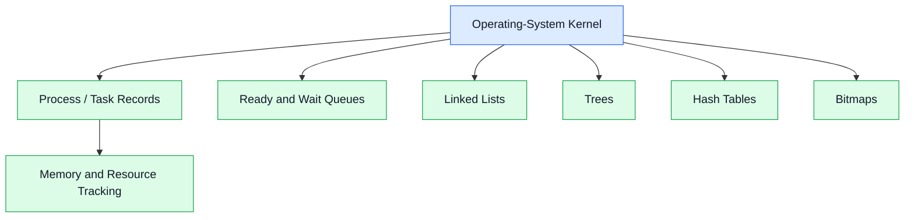

**বাংলায় Diagram:** Kernel-এর বিভিন্ন subsystem তাদের কাজ অনুযায়ী data structure ব্যবহার করে। যেমন, scheduler queue ব্যবহার করতে পারে, memory subsystem bitmap বা tree ব্যবহার করতে পারে এবং lookup-এর জন্য hash table ব্যবহার করা যেতে পারে।

### Importance of Kernel Data Structures

1. Organize kernel information.
2. Support efficient searching and updating.
3. Help implement scheduling and resource allocation.
4. Maintain process and memory information.
5. Improve kernel performance when appropriate structures are chosen.

### Conclusion

Kernel data structures are essential because they allow the operating system to maintain and process system information efficiently.

---

# Q12. Process State

## 1. সহজ বাংলা ব্যাখ্যা

Process State হলো execution-এর কোনো নির্দিষ্ট সময়ে একটি process-এর অবস্থা।

একটি process সব সময় CPU-তে চলতে থাকে না। কখনো CPU-এর জন্য অপেক্ষা করে, কখনো I/O operation-এর জন্য অপেক্ষা করে, আবার কখনো কাজ শেষ করে।

পাঁচটি সাধারণ process state:

1. **New:** Process তৈরি হচ্ছে।
2. **Ready:** CPU পাওয়ার জন্য প্রস্তুত।
3. **Running:** CPU-তে execute হচ্ছে।
4. **Waiting/Blocked:** কোনো event বা I/O শেষ হওয়ার অপেক্ষায়।
5. **Terminated:** Process-এর execution শেষ।

### State Transition

- New → Ready: Process admission সম্পন্ন।
- Ready → Running: Scheduler CPU দেয়।
- Running → Ready: Preemption বা time slice শেষ।
- Running → Waiting: I/O বা event-এর জন্য অপেক্ষা।
- Waiting → Ready: অপেক্ষার event শেষ।
- Running → Terminated: Process শেষ।

## 2. Real-Life Example

একজন শিক্ষার্থী assignment করছে।

- Assignment তৈরি করার পরিকল্পনা: New।
- কাজ শুরু করার জন্য প্রস্তুত: Ready।
- বর্তমানে লিখছে: Running।
- বই বা তথ্য খুঁজছে: Waiting।
- Assignment জমা দিয়েছে: Terminated।

## 3. Exam-Ready English Answer

### Definition

A process state represents the current execution condition of a process as maintained by the operating system.

### Five-State Process Model

**1. New:** The process is being created.

**2. Ready:** The process is prepared to execute but is waiting for CPU allocation.

**3. Running:** The process is currently executing on a CPU core.

**4. Waiting or Blocked:** The process is waiting for an event, such as completion of an I/O operation.

**5. Terminated:** The process has finished or has been terminated.

### Diagram: Process States

```mermaid
flowchart TD
    N(["New"])
    R(["Ready"])
    X(["Running"])
    W(["Waiting / Blocked"])
    T(["Terminated"])

    N -->|"Admitted"| R
    R -->|"CPU Dispatch"| X
    X -->|"Preemption"| R
    X -->|"I/O or Event Wait"| W
    W -->|"Event Complete"| R
    X -->|"Exit"| T

    classDef active fill:#DCEBFF,stroke:#2563EB,color:#111827
    classDef waiting fill:#FEF3C7,stroke:#D97706,color:#111827
    classDef end fill:#FEE2E2,stroke:#DC2626,color:#111827

    class N,R,X active
    class W waiting
    class T end
```

**বাংলায় Diagram:** Ready process CPU পেলে Running হয়। I/O-এর প্রয়োজন হলে Waiting হয়। Event শেষ হলে Ready-তে ফেরে। কাজ শেষ হলে Terminated হয়।

### Importance of Process States

- Help the OS track execution progress.
- Support CPU scheduling.
- Enable efficient waiting and wake-up handling.
- Help manage context switching.

### Conclusion

Process states describe the lifecycle of a process and help the operating system decide which processes can execute and which must wait.

---

# Q13. Process Control Block (PCB)

## 1. সহজ বাংলা ব্যাখ্যা

PCB-এর পূর্ণরূপ Process Control Block। এটি OS-এর সংরক্ষিত একটি data structure, যেখানে একটি process পরিচালনার জন্য প্রয়োজনীয় গুরুত্বপূর্ণ তথ্য থাকে।

যেমন, OS-কে জানতে হয়:

- Process-এর ID কী?
- Process কোন state-এ আছে?
- শেষ কোথায় instruction execute হচ্ছিল?
- CPU scheduling information কী?
- Memory information কোথায়?
- কোন I/O resource বা file-এর সঙ্গে সম্পর্ক আছে?

এই তথ্যগুলো PCB বা সংশ্লিষ্ট kernel structures-এ রাখা হয়।

**Context switch-এর সময় PCB বা সংশ্লিষ্ট kernel records-এ থাকা execution state ব্যবহার করে process-কে পরে আবার চালানো যায়।**

## 2. Real-Life Example

একটি অফিসের প্রতিটি কর্মীর personal file থাকে। সেখানে employee ID, department, কাজের অবস্থা ও দায়িত্ব লেখা থাকে।

PCB-ও process-এর management record-এর মতো।

## 3. Exam-Ready English Answer

### Definition

A Process Control Block (PCB) is a kernel-maintained data structure containing information required by the operating system to manage and control a process.

### Main Contents of a PCB

**1. Process Identification:**
Contains the process ID (PID) and may contain related identifiers.

**2. Process State:**
Records whether the process is ready, running, waiting, or in another state.

**3. Program Counter:**
Stores the address of the next instruction to execute, or the relevant saved instruction position.

**4. CPU Registers:**
Contains saved register values required to resume execution.

**5. CPU-Scheduling Information:**
May include scheduling priority, queue links, and other scheduling-related information.

**6. Memory-Management Information:**
May include references to page tables, address-space information, or memory mappings.

**7. I/O and File Information:**
May include references to open files, I/O resources, and related kernel objects.

**8. Accounting Information:**
May include CPU usage, process creation time, or other accounting data.

The exact PCB layout varies between operating systems.

### Diagram: PCB

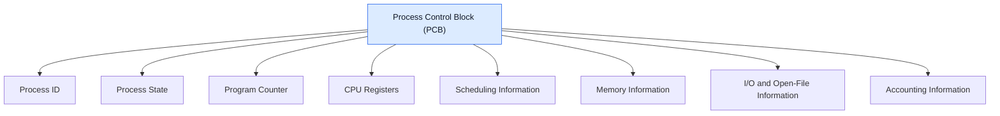

**বাংলায় Diagram:** PCB-এর মধ্যে process-এর পরিচয়, state, execution position, register values, scheduling এবং memory-related information-এর মতো তথ্য থাকে।

### Role of PCB in Context Switching

1. The CPU is executing Process A.
2. The OS decides to switch to another process.
3. The required execution state of Process A is saved in its PCB or associated kernel records.
4. The OS selects Process B.
5. The saved execution state of Process B is restored.
6. Process B resumes execution.

### Importance of PCB

- Helps identify and manage processes.
- Supports context switching.
- Stores scheduling-related information.
- Maintains references to process resources.
- Helps the OS track process execution.

### Conclusion

The PCB is essential for process management because it stores the information required to track, schedule, and resume a process.

---

# Q14. Multitasking

## 1. সহজ বাংলা ব্যাখ্যা

Multitasking হলো OS-এর এমন capability, যার মাধ্যমে একাধিক task-কে এমনভাবে পরিচালনা করা হয় যে user একাধিক কাজ একসঙ্গে চলছে বলে অনুভব করেন।

Single-core system-এ OS অল্প অল্প CPU time বিভিন্ন task-কে দিতে পারে। একে time-sharing বা time-slicing-এর মাধ্যমে করা হয়।

Multicore system-এ কিছু task সত্যিকার অর্থে parallel execute হতে পারে।

### Types of Multitasking

**1. Preemptive Multitasking:**
OS নির্দিষ্ট নিয়ম অনুযায়ী চলমান task-এর CPU time শেষ হলে বা প্রয়োজন হলে তাকে থামিয়ে অন্য task চালাতে পারে।

**2. Cooperative Multitasking:**
Task নিজে control ছেড়ে দিলে বা নির্দিষ্ট yield point-এ পৌঁছালে অন্য task চালানো হয়।

## 2. Real-Life Example

তুমি একই সময়ে music শুনছ, browser ব্যবহার করছ এবং document লিখছ। OS দ্রুত task-গুলোর মধ্যে CPU time ভাগ করে দেয়। তাই সবগুলো কাজ একসঙ্গে চলছে বলে মনে হয়।

## 3. Exam-Ready English Answer

### Definition

Multitasking is an operating-system capability that allows multiple tasks to make progress during the same period by sharing CPU time or executing on multiple processing cores.

### Types of Multitasking

**1. Preemptive Multitasking:**
The operating system can interrupt a running task and schedule another task according to its scheduling policy.

**2. Cooperative Multitasking:**
A running task voluntarily yields control so that another task can execute.

### Working Principle

1. Multiple tasks are available.
2. The OS maintains scheduling information.
3. A scheduler selects a task.
4. The selected task receives CPU time.
5. The OS may switch tasks when the time slice expires, a higher-priority task becomes eligible, or the running task blocks.
6. Other tasks receive CPU time according to the scheduling policy.

### Diagram: Multitasking

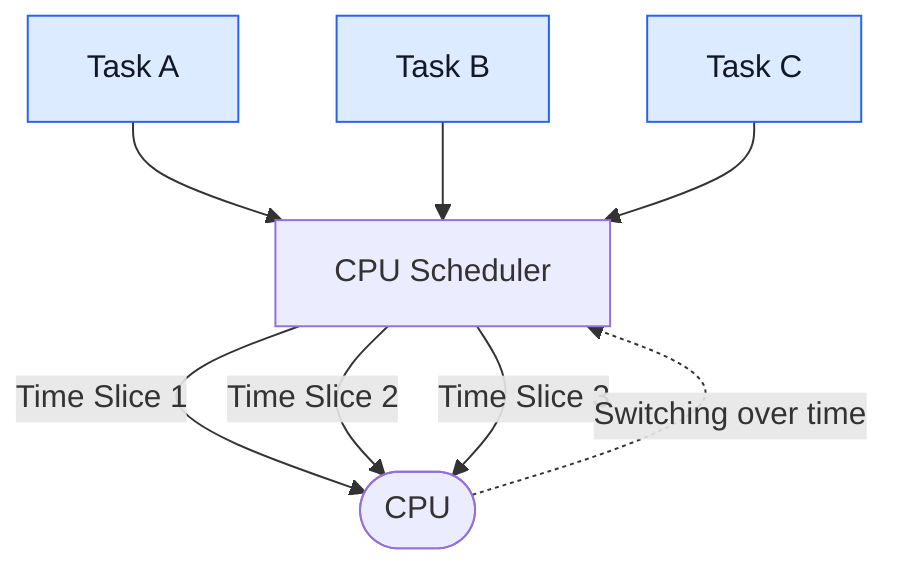

**বাংলায় Diagram:** Scheduler বিভিন্ন task-কে CPU time দেয়। Single-core system-এ task-গুলো দ্রুত পালাক্রমে চলে; multicore system-এ আলাদা core-এ parallel execution-ও সম্ভব।

### Advantages of Multitasking

1. Improves responsiveness.
2. Supports multiple running applications.
3. Improves CPU utilization.
4. Allows background tasks to operate.
5. Supports interactive computing.

### Conclusion

Multitasking makes a computer more responsive by coordinating multiple tasks and sharing available processing resources.

---

# Q15. What Is a Thread? Explain Threads in an Operating System.

## 1. সহজ বাংলা ব্যাখ্যা

Thread হলো process-এর ভেতরে execution-এর একটি unit। একটি process-এর এক বা একাধিক thread থাকতে পারে।

একটি process-এর thread-গুলো সাধারণত একই process-এর address space এবং অনেক resource share করে। তবে প্রত্যেক thread-এর নিজস্ব execution state থাকে, যেমন:

- Program counter।
- CPU registers।
- Stack।
- Scheduling state।

একই process-এর thread-গুলো shared memory ব্যবহার করতে পারে। তাই communication সহজ হয়, কিন্তু shared data একসঙ্গে access করলে synchronization প্রয়োজন হতে পারে।

### Types of Threads

**1. User-Level Threads:**
User-space library দ্বারা পরিচালিত হয়। Kernel সবসময় প্রতিটি user thread-কে আলাদা kernel thread হিসেবে দেখে না।

**2. Kernel-Level Threads:**
Operating-system kernel thread-গুলোকে সরাসরি manage ও schedule করে।

User-level ও kernel-level thread-এর mapping implementation অনুযায়ী ভিন্ন হতে পারে।

## 2. Real-Life Example

একটি restaurant হলো process। সেই restaurant-এর মধ্যে:

- একজন order নিচ্ছেন।
- একজন খাবার তৈরি করছেন।
- একজন payment নিচ্ছেন।

সবাই একই restaurant-এর resources ব্যবহার করছেন, কিন্তু কাজ আলাদা।

একইভাবে একটি process-এর বিভিন্ন thread আলাদা কাজ করতে পারে।

## 3. Exam-Ready English Answer

### Definition

A thread is the smallest unit of CPU execution and scheduling recognized by a particular execution environment. A process may contain one or more threads that share process resources while maintaining their own execution states.

### Characteristics of Threads

1. Each thread has its own program counter and CPU register state.
2. Each thread has its own stack.
3. Threads within the same process share the process address space.
4. They can share open files and other process resources.
5. Threads can communicate efficiently through shared memory.
6. Concurrent access to shared data may require synchronization.
7. Multiple threads may execute in parallel on different CPU cores.

### Types of Threads

**1. User-Level Threads:**
These are managed primarily by a user-space threading library. Their scheduling and kernel visibility depend on the threading model.

**2. Kernel-Level Threads:**
These are managed by the operating-system kernel, which can schedule them as kernel execution entities.

### Diagram: Threads in a Process

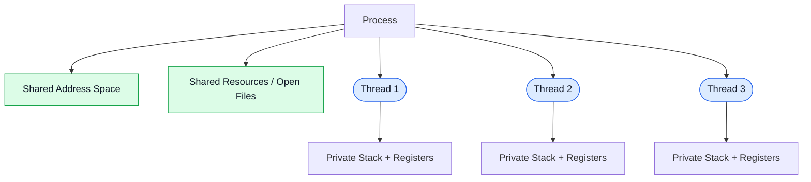

**বাংলায় Diagram:** একই process-এর thread-গুলো shared address space ও process resources ব্যবহার করে। তবে প্রতিটি thread-এর নিজস্ব stack এবং execution state থাকে।

### Advantages of Threads

1. **Responsiveness:** One thread may continue while another waits for I/O.
2. **Resource Sharing:** Threads share resources within a process.
3. **Lower Overhead in Many Cases:** Creating and switching threads can be cheaper than creating and switching independent processes, depending on the OS.
4. **Parallelism:** Threads can execute on multiple cores.
5. **Simplified Communication:** Shared-memory communication is often convenient.

### Limitations

- Shared data can cause race conditions.
- Synchronization is necessary for safe concurrent access.
- A faulty thread can affect other threads in the same process.
- Debugging concurrent programs can be difficult.

### Conclusion

Threads provide multiple execution paths within a process, improving responsiveness and enabling concurrent or parallel work.

---

# Q16. What Is Process Scheduling? Explain the Process Scheduling Queues.

## 1. সহজ বাংলা ব্যাখ্যা

Process Scheduling হলো OS-এর এমন কাজ, যেখানে ready process বা thread-এর মধ্যে কোনটি CPU পাবে তা নির্ধারণ করা হয়।

সব process একই সময়ে CPU পায় না। তাই OS queue ব্যবহার করে process-গুলোকে সংগঠিত রাখে।

### Main Scheduling Queues

**1. Job Queue:**
System-এ জমা হওয়া job বা process-এর সামগ্রিক collection বোঝাতে ব্যবহৃত হয়। এর সুনির্দিষ্ট অর্থ system model অনুযায়ী ভিন্ন হতে পারে।

**2. Ready Queue:**
CPU পাওয়ার জন্য প্রস্তুত process-গুলো এখানে থাকে।

**3. Device/Waiting Queue:**
কোনো I/O device বা event-এর জন্য অপেক্ষমাণ process এখানে থাকে।

Process scheduling-এর লক্ষ্য হলো CPU utilization, throughput, response time, waiting time এবং fairness-এর মধ্যে ভালো balance তৈরি করা।

## 2. Real-Life Example

একটি হাসপাতাল কল্পনা করো।

- সব registration করা রোগী: Job Queue।
- ডাক্তার দেখানোর জন্য প্রস্তুত রোগী: Ready Queue।
- পরীক্ষার রিপোর্টের জন্য অপেক্ষমাণ রোগী: Waiting Queue।
- ডাক্তার দেখাচ্ছেন: Running।

## 3. Exam-Ready English Answer

### Definition

Process scheduling is the operating-system activity of selecting a process or thread for execution on a CPU according to a scheduling policy.

### Types of Scheduling Queues

**1. Job Queue:**
Contains jobs or processes submitted to the system, depending on the system model.

**2. Ready Queue:**
Contains processes in main memory that are ready to execute and are waiting for CPU allocation.

**3. Device or Waiting Queue:**
Contains processes waiting for a device operation or another event.

### Process Scheduling Queue Diagram

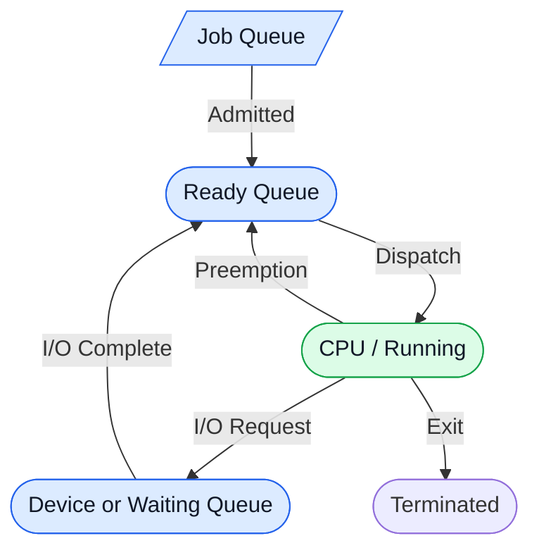

**বাংলায় Diagram:** Job admission-এর পর process ready queue-তে আসে। CPU পেলে Running হয়। I/O-এর জন্য অপেক্ষা করলে waiting queue-তে যায়। I/O শেষ হলে আবার Ready Queue-তে ফিরে আসে।

### Objectives of Process Scheduling

1. Maximize CPU utilization.
2. Increase throughput.
3. Minimize waiting time.
4. Minimize turnaround time.
5. Improve response time.
6. Maintain fairness and avoid starvation where possible.

### Common Scheduling Algorithms

- **First-Come, First-Served (FCFS):** Processes are served in arrival order.
- **Shortest Job First (SJF):** Selects the process with the shortest estimated CPU burst.
- **Priority Scheduling:** Selects according to priority.
- **Round Robin (RR):** Gives each ready process a time quantum in rotation.
- **Multilevel Queue:** Uses multiple queues for different classes of processes.

### Conclusion

Process scheduling queues organize processes according to their execution status and allow the scheduler to allocate CPU time efficiently.

---

# Q17. Schedulers

## 1. সহজ বাংলা ব্যাখ্যা

Scheduler হলো OS-এর সেই component, যা process বা thread নির্বাচন করে execution এবং resource allocation পরিচালনায় সাহায্য করে।

Operating System-এর textbook model-এ সাধারণত তিন ধরনের scheduler আলোচনা করা হয়:

1. **Long-Term Scheduler:** কোন job system-এ admit হবে, তা নির্বাচন করে।
2. **Short-Term Scheduler:** Ready Queue থেকে কোন process CPU পাবে, তা নির্বাচন করে।
3. **Medium-Term Scheduler:** প্রয়োজনে process suspend করে memory থেকে সরানো এবং পরে আবার ফিরিয়ে আনার কাজে ভূমিকা রাখে।

সব operating system-এ এই তিনটি scheduler আলাদা component হিসেবে থাকে না। এগুলো মূলত scheduling-এর দায়িত্ব বোঝানোর conceptual classification।

## 2. Real-Life Example

একটি বিশ্ববিদ্যালয়ে:

- Long-term scheduler: কোন শিক্ষার্থী ভর্তি হবে।
- Short-term scheduler: কোন শিক্ষার্থী এখন শিক্ষকের সঙ্গে দেখা করবে।
- Medium-term scheduler: কোনো শিক্ষার্থীর কার্যক্রম সাময়িক স্থগিত করে পরে আবার চালু করা।

## 3. Exam-Ready English Answer

### Definition

A scheduler is an operating-system component that selects processes or threads for admission, CPU execution, or suspension according to system policies.

### Types of Schedulers

**1. Long-Term Scheduler (Job Scheduler):**
Selects jobs or processes to admit into the system. It influences the degree of multiprogramming and the balance of admitted workloads.

**2. Short-Term Scheduler (CPU Scheduler):**
Selects a process or thread from the ready queue for CPU execution. It is invoked frequently and must operate efficiently.

**3. Medium-Term Scheduler:**
Temporarily suspends processes and may remove their memory-resident state from main memory, then later arrange for them to resume. This is associated with swapping or suspended-process management in systems that use such mechanisms.

### Diagram: Schedulers

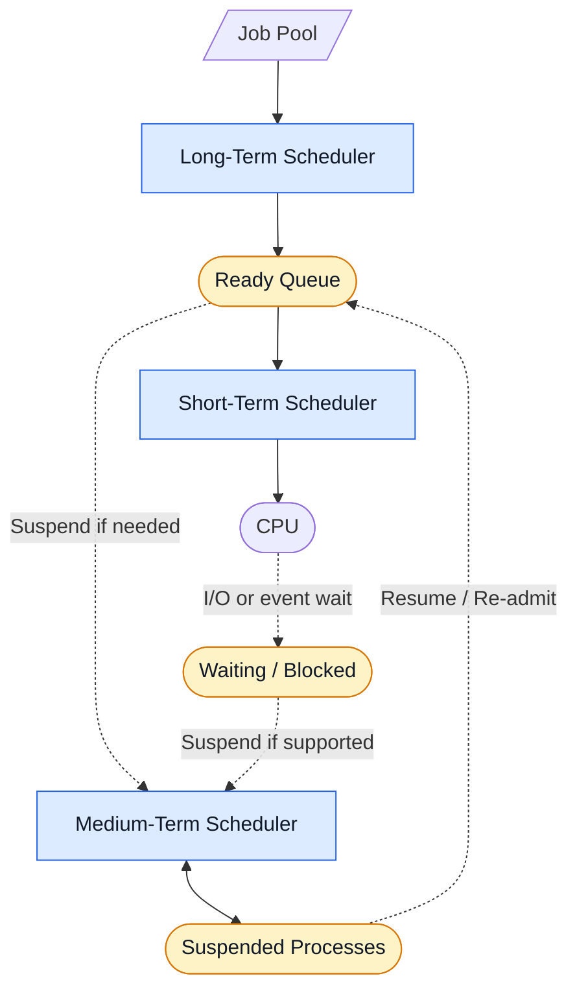

**বাংলায় Diagram:** Long-term scheduler job admit করে, short-term scheduler ready queue থেকে CPU-এর জন্য process বেছে নেয়, আর medium-term scheduler সমর্থিত system-এ process suspend ও resume করতে সাহায্য করে।

### Comparison of Schedulers

| Feature | Long-Term Scheduler | Short-Term Scheduler | Medium-Term Scheduler |
|---|---|---|---|
| Main purpose | Admit jobs/processes | Select CPU execution target | Suspend/resume processes |
| Selection source | Job pool | Ready queue | Processes eligible for suspension/resumption |
| Frequency | Relatively infrequent | Very frequent | Depends on system needs |
| Main concern | Degree and mix of multiprogramming | CPU allocation | Memory pressure and suspended work |
| Common name | Job scheduler | CPU scheduler | Swapping/suspension scheduler |

### Conclusion

Schedulers perform different selection tasks that help the operating system control admission, CPU execution, and process suspension.

---

# Q18. Explain Multiprocess Architecture in the Google Chrome Browser.

## 1. সহজ বাংলা ব্যাখ্যা

Google Chrome-এর architecture বোঝার জন্য একটি বিষয় মনে রাখবে: **একটি browser application মানেই একটি OS process নয়।**

Chromium project-এর architecture অনুযায়ী browser-কে বিভিন্ন process-এ ভাগ করা হয়, যাতে user interface, web content rendering এবং অন্যান্য কাজ আলাদা execution environment-এ পরিচালনা করা যায়।

প্রধান process types:

**1. Browser Process:**
Browser window, tabs-এর coordination, navigation এবং বিভিন্ন browser-level operation পরিচালনা করে।

**2. Renderer Process:**
Web content-এর HTML parsing, CSS layout এবং JavaScript execution-এর মতো কাজ করে।

**3. GPU Process:**
Graphics-related কাজ এবং GPU-সংশ্লিষ্ট operation পরিচালনায় ব্যবহৃত হতে পারে।

**4. Utility Processes:**
কিছু আলাদা service বা কাজকে পৃথক process-এ পরিচালনা করে।

**5. Network Service:**
Network request এবং সম্পর্কিত functionality পরিচালনা করে; এটি কোন process-এ চলে তা implementation ও configuration অনুযায়ী ভিন্ন হতে পারে।

### গুরুত্বপূর্ণ সতর্কতা

প্রতিটি tab-এর জন্য সবসময় ঠিক একটি process থাকবে—এটি সঠিক নিয়ম নয়। Chromium-এর process model অনুযায়ী process একাধিক document বা frame share করতে পারে, আবার site isolation-এর কারণে একটি tab-এর বিভিন্ন অংশ আলাদা process-এও থাকতে পারে। Process assignment browser version, site relationships, security policy এবং resource constraints-এর ওপর নির্ভর করে।

## 2. Real-Life Example

একটি বড় প্রতিষ্ঠানে আলাদা team আছে:

- Management team: Browser Process।
- Content team: Renderer Process।
- Graphics team: GPU Process।
- Support team: Utility Process।
- Communication team: Network Service।

একটি team-এ সমস্যা হলে অন্য team-এর সব কাজ থেমে যাওয়া বাধ্যতামূলক নয়। আলাদা process architecture-এর অন্যতম উদ্দেশ্য হলো isolation এবং stability বাড়ানো।

## 3. Exam-Ready English Answer

### Definition

Multiprocess architecture is a design in which an application uses multiple operating-system processes to separate responsibilities, isolate execution environments, and improve reliability and security.

Chromium, the open-source project underlying Google Chrome, uses a multiprocess architecture for browser functionality and web-content processing.

### Main Components

**1. Browser Process:**
Manages the browser user interface and coordinates browser-level activities, navigation, and communication with other processes.

**2. Renderer Processes:**
Process web content, including HTML parsing, layout, and JavaScript execution. Renderers may be isolated from one another according to the browser's process model.

**3. GPU Process:**
Handles graphics-related operations and coordination with graphics hardware where applicable.

**4. Utility Processes:**
Handle selected services or components in separate processes when the architecture requires isolation.

**5. Network Service:**
Provides network-related functionality. Its exact process placement and implementation may vary by version and configuration.

### Diagram: Chrome's Multiprocess Architecture

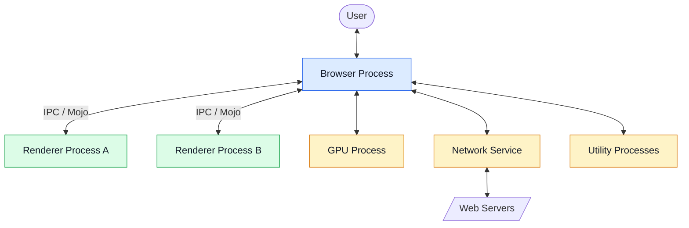

**বাংলায় Diagram:** Browser Process অন্য process-গুলোর কাজ coordinate করে। Renderer web content process করে। GPU ও utility process graphics এবং অন্যান্য দায়িত্ব পালন করতে পারে। Process-গুলোর মধ্যে IPC বা Mojo-এর মতো communication mechanism ব্যবহার করা হয়। Diagram-টি conceptual; এটি সব version-এর exact process layout নয়।

### Advantages of Chrome's Multiprocess Architecture

**1. Stability:**
A renderer crash can often be isolated so that unrelated tabs or the browser UI can continue working.

**2. Security:**
Sandboxing and process isolation can limit the access available to compromised web content.

**3. Performance:**
Different processes can execute concurrently and may run in parallel on multiple CPU cores.

**4. Resource Management:**
The browser can monitor and manage process resource usage.

**5. Fault Isolation:**
Separating components can reduce the impact of certain failures.

### Limitations

- Multiple processes require additional memory.
- Inter-process communication introduces overhead.
- Process creation and management add complexity.
- Isolation does not guarantee that every failure will be contained.

### Conclusion

Chrome's multiprocess architecture separates browser functions and web-content execution into different processes. This improves isolation, stability, and security, although the exact process arrangement can vary with Chromium's implementation and configuration.

### Reference

Chromium's official documentation:
https://www.chromium.org/developers/design-documents/multi-process-architecture/

---

# Q19. What Is Message Passing?

## 1. সহজ বাংলা ব্যাখ্যা

Message Passing হলো এমন একটি Inter-Process Communication (IPC) mechanism, যার মাধ্যমে process-গুলো message send এবং receive করে তথ্য আদান-প্রদান করে।

Shared memory-তে process-গুলো common memory region ব্যবহার করতে পারে। কিন্তু message passing-এ তারা communication mechanism-এর মাধ্যমে message পাঠায়।

প্রধান operations:

- `send(message)`
- `receive(message)`

Message passing হতে পারে:

**1. Direct Communication:**
Sender ও receiver একে অপরকে সরাসরি identify করে।

**2. Indirect Communication:**
Mailbox বা port-এর মতো intermediate communication object ব্যবহার করা হয়।

**3. Blocking Communication:**
Operation সম্পন্ন না হওয়া পর্যন্ত process অপেক্ষা করতে পারে।

**4. Non-Blocking Communication:**
Operation-এর কারণে process-কে বাধ্যতামূলকভাবে অপেক্ষা করতে হয় না।

## 2. Real-Life Example

দুই বন্ধু চিঠির মাধ্যমে যোগাযোগ করছে।

- Sender: Message পাঠায়।
- Mailbox বা post office: Message পৌঁছাতে সাহায্য করে।
- Receiver: Message গ্রহণ করে।

Process-এর message passing-ও একই ধরনের communication model অনুসরণ করতে পারে।

## 3. Exam-Ready English Answer

### Definition

Message passing is an inter-process communication mechanism in which processes exchange information by sending and receiving messages through an operating-system-supported or application-provided communication mechanism.

### Basic Operations

**Send:** Transfers a message to a destination, port, or mailbox.

**Receive:** Obtains a message from a sender, port, or mailbox.

### Types of Message Passing

**1. Direct Communication:**
The sender and receiver explicitly identify each other.

**2. Indirect Communication:**
Processes communicate through a mailbox, message queue, or port.

**3. Blocking Communication:**
A send or receive operation may wait until a specified condition is satisfied.

**4. Non-Blocking Communication:**
A send or receive operation returns without necessarily waiting for the communication to complete.

### Diagram: Message Passing


**বাংলায় Diagram:** Process A একটি message mailbox বা queue-তে পাঠায়। Process B সেই message গ্রহণ করে। বাস্তবে message copying, buffering এবং synchronization-এর নিয়ম implementation অনুযায়ী আলাদা হতে পারে।

### Advantages

1. Provides communication between independent processes.
2. Supports distributed systems.
3. Can reduce the need for direct shared-memory access.
4. Helps maintain process isolation.
5. Supports modular application design.

### Limitations

- Message transfer introduces overhead.
- Buffering and message ordering must be managed.
- Communication failures must be handled.
- Large messages can consume additional memory and processing time.

### Conclusion

Message passing allows processes to communicate by exchanging messages and is widely used in operating systems, distributed applications, and service-oriented architectures.

---

# Q20. Synchronization

## 1. সহজ বাংলা ব্যাখ্যা

Synchronization হলো একাধিক process বা thread-এর execution সমন্বয় করা, যাতে তারা shared resources ব্যবহার করার সময় ভুল ফলাফল তৈরি না করে।

ধরো, একটি bank account-এ 1,000 টাকা আছে। দুটি thread একই সময়ে 500 টাকা করে তুলতে চায়। যদি দুটো thread balance একই সময়ে পড়ে এবং সঠিকভাবে coordination ছাড়া update করে, তাহলে ভুল balance তৈরি হতে পারে।

এটি race condition-এর একটি উদাহরণ।

### গুরুত্বপূর্ণ ধারণা

**Race Condition:** ফলাফল নির্ভর করে concurrent operation-গুলোর timing বা execution order-এর ওপর।

**Critical Section:** Program-এর সেই অংশ, যেখানে shared data বা resource access করা হয় এবং যেখানে coordination প্রয়োজন হতে পারে।

**Mutex:** এক সময়ে একটি thread-কে critical section-এ প্রবেশ করতে দেয়, যদি mutex সঠিকভাবে ব্যবহার করা হয়।

**Semaphore:** Counter-ভিত্তিক synchronization primitive, যা resource access বা coordination নিয়ন্ত্রণে ব্যবহার করা যায়।

**Monitor:** Shared state এবং synchronization operations একত্রে সংগঠিত করার একটি high-level construct।

## 2. Real-Life Example

একটি মাত্র key দিয়ে খোলা যায় এমন store room কল্পনা করো। একজন কর্মী room-এ থাকলে অন্য কর্মীকে অপেক্ষা করতে হয়। প্রথম কর্মী বের হয়ে key ছেড়ে দিলে পরেরজন প্রবেশ করতে পারে।

Mutex এই ধরনের exclusive access-এর মতো কাজ করে।

## 3. Exam-Ready English Answer

### Definition

Synchronization is the coordination of concurrent processes or threads to ensure correct access to shared data and resources and to maintain the required execution order.

### Why Synchronization Is Needed

When multiple threads access and modify shared data concurrently, their operations may interleave unpredictably. Without appropriate coordination, a race condition can occur and produce incorrect results.

### Critical Section

A critical section is a part of a program that accesses shared data or resources and therefore requires appropriate coordination when concurrent access could cause incorrect behavior.

A typical critical-section solution aims to satisfy:

**1. Mutual Exclusion:**
Only one participant at a time enters the protected critical section when exclusive access is required.

**2. Progress:**
If no participant is in the critical section, the decision about who enters next should not be postponed indefinitely by processes that are not trying to enter.

**3. Bounded Waiting:**
A participant requesting entry should not wait indefinitely while others repeatedly enter, under the assumptions of the particular solution.

### Common Synchronization Mechanisms

**1. Mutex Locks:**
Provide exclusive access to a protected resource.

**2. Semaphores:**
Use a counter and atomic operations to coordinate resource access or execution order.

**3. Monitors:**
Combine shared data and synchronized operations within a structured abstraction.

**4. Condition Variables:**
Allow threads to wait for and signal specific conditions, typically alongside a mutex.

**5. Atomic Operations:**
Provide indivisible operations that can be used to implement synchronization mechanisms.

### Diagram: Synchronization

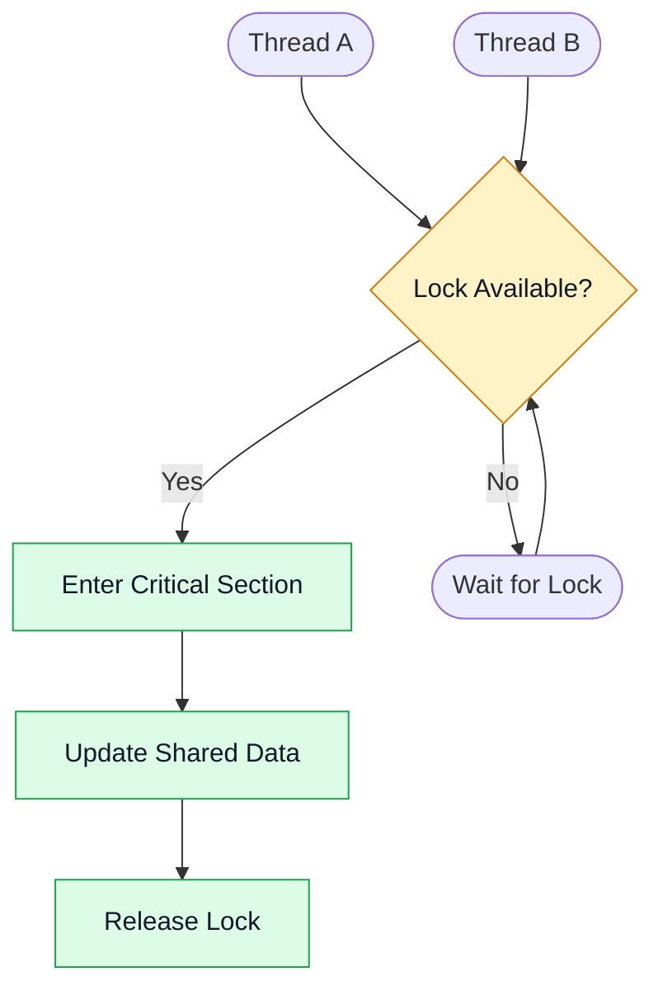

**বাংলায় Diagram:** Thread lock পেলে critical section-এ প্রবেশ করে shared data update করে এবং শেষে lock release করে। Lock না পেলে অন্য thread অপেক্ষা করে। বাস্তব implementation-এ locking protocol সঠিকভাবে মানতে হয়।

### Advantages of Synchronization

1. Prevents race conditions when used correctly.
2. Protects shared data.
3. Maintains required execution order.
4. Supports reliable concurrent programming.
5. Coordinates access to limited resources.

### Problems Associated with Synchronization

- **Deadlock:** Tasks wait indefinitely for resources held by one another.
- **Starvation:** A task may wait indefinitely because it is repeatedly denied access.
- **Livelock:** Tasks remain active but fail to make useful progress.
- **Performance Overhead:** Locking and coordination may reduce parallelism.

### Conclusion

Synchronization is essential for safe concurrent execution because it coordinates access to shared resources and protects data consistency.

---

# Q21. What Is a Socket? Explain Sockets in an Operating System.

## 1. সহজ বাংলা ব্যাখ্যা

Socket হলো communication endpoint, যার মাধ্যমে application data send এবং receive করতে পারে।

Network programming-এ socket ব্যবহার করে দুইটি application একই computer-এ অথবা network-এর মাধ্যমে আলাদা computer-এ যোগাযোগ করতে পারে।

উদাহরণ:

- Browser একটি server-এর সঙ্গে যোগাযোগ করে।
- Chat application message পাঠায়।
- Game client game server-এর সঙ্গে data আদান-প্রদান করে।

### Socket-এর গুরুত্বপূর্ণ ধরন

**1. Stream Socket:**
সাধারণত TCP ব্যবহার করে। এটি reliable, ordered byte stream communication দেয়।

**2. Datagram Socket:**
সাধারণত UDP ব্যবহার করে। এটি datagram পাঠায়, কিন্তু delivery বা ordering নিশ্চিত করে না।

**3. Local/Unix-Domain Socket:**
একই operating system-এ local process communication-এর জন্য ব্যবহৃত হতে পারে।

একটি network socket-কে protocol, IP address এবং port-এর মতো information দিয়ে identify করা যায়; exact representation system ও protocol অনুযায়ী ভিন্ন হতে পারে।

## 2. Real-Life Example

একটি ফোন কল কল্পনা করো।

- তোমার ফোন: Client socket।
- অপর প্রান্তের ফোন: Server socket।
- Phone number: যোগাযোগের destination চিহ্নিত করার analogy।
- কথাবার্তা: Data transfer।

তবে বাস্তবে socket address এবং network protocol ফোন নম্বরের মতো এক জিনিস নয়; analogy-টি শুধু ধারণা বোঝানোর জন্য।

## 3. Exam-Ready English Answer

### Definition

A socket is a communication endpoint through which an application sends and receives data. Sockets are commonly used for communication between processes over a network and can also support local inter-process communication.

### Types of Sockets

**1. Stream Sockets:**
Usually associated with TCP, stream sockets provide a reliable, ordered byte stream between connected endpoints.

**2. Datagram Sockets:**
Usually associated with UDP, datagram sockets send individual messages without guaranteeing delivery, ordering, or duplicate protection.

**3. Local-Domain Sockets:**
These support communication between processes on the same machine using an operating-system-provided local communication mechanism.

### Basic Client-Server Communication

1. The server creates a socket.
2. The server binds the socket to a local address and port when required.
3. A TCP server listens for incoming connections.
4. A client creates a socket and connects to the server.
5. The endpoints exchange data.
6. The communication is closed when it is no longer needed.

The exact steps differ between TCP, UDP, and local sockets.

### Diagram: Socket Communication


**বাংলায় Diagram:** Client application তার socket দিয়ে server-এর socket-এ data পাঠায়। Server application সেই data গ্রহণ করে এবং প্রয়োজন অনুযায়ী response পাঠায়।

### Advantages of Sockets

1. Enable communication between networked applications.
2. Support client-server architecture.
3. Support multiple communication protocols.
4. Allow applications to exchange data across machines.
5. Support both local and network communication.

### Conclusion

Sockets provide a standard programming interface for communication between applications and are fundamental to network services and distributed systems.

---

# Q22. Differentiate Between Process and Thread

## 1. সহজ বাংলা ব্যাখ্যা

Process হলো একটি running program-এর execution environment। Thread হলো সেই process-এর ভেতরে execution-এর একটি unit।

একটি process-এর একাধিক thread থাকতে পারে। একই process-এর thread-গুলো সাধারণত address space ও অনেক resource share করে, কিন্তু প্রতিটি thread-এর নিজস্ব stack, register state এবং execution position থাকে।

অন্যদিকে, আলাদা process-এর address space সাধারণত পৃথক থাকে এবং তারা IPC-এর মাধ্যমে communication করতে পারে।

## 2. Real-Life Example

একটি restaurant হলো process।

Restaurant-এর মধ্যে:

- Order নেওয়া।
- খাবার তৈরি করা।
- Payment নেওয়া।

এগুলো আলাদা thread-এর মতো কাজ করতে পারে।

অন্যদিকে, পাশের restaurant একটি আলাদা process-এর মতো। তাদের নিজস্ব workspace থাকে এবং প্রয়োজনে communication করতে হয়।

## 3. Exam-Ready English Answer

### Definition of Process

A process is an instance of a program in execution, together with its address space, resources, and associated operating-system management information.

### Definition of Thread

A thread is an execution unit within a process. Threads in the same process typically share the process address space and many resources but maintain separate execution states.

### Differences Between Process and Thread

| Basis | Process | Thread |
|---|---|---|
| Definition | An instance of a program in execution. | An execution unit within a process. |
| Address Space | Normally has its own virtual address space. | Shares the containing process's address space. |
| Resource Ownership | Owns or references process-level resources. | Uses resources belonging to its process. |
| Execution State | Has process-level state and at least one execution thread. | Has its own execution state, including registers and stack. |
| Communication | Often uses IPC, such as pipes, sockets, or shared memory. | Can communicate through shared process memory. |
| Creation Overhead | Often higher than thread creation, depending on the OS. | Often lower than process creation, depending on the OS. |
| Context Switching | May involve address-space and other process-related changes. | May be cheaper when switching between threads in the same process. |
| Isolation | Separate address spaces usually provide stronger isolation. | Threads within a process are not isolated from one another's address space. |
| Failure Impact | A process crash is often isolated from other processes. | An unhandled failure in a thread may terminate or corrupt the entire process. |
| Synchronization | IPC or shared-memory synchronization may be needed. | Shared-data synchronization is often necessary between threads. |
| Parallelism | Processes can run in parallel on multiple cores. | Threads can also run in parallel on multiple cores. |
| Example | A browser process or text-editor process. | A worker thread inside a browser or text editor. |

### Diagram: Process and Thread

```mermaid
flowchart TB
    P1["Process A"]
    A1["Address Space A"]
    T1(["Thread A1"])
    T2(["Thread A2"])
    T3(["Thread A3"])

    P2["Process B"]
    B1["Address Space B"]
    T4(["Thread B1"])

    P1 --> A1
    P1 --> T1
    P1 --> T2
    P1 --> T3

    P2 --> B1
    P2 --> T4

    classDef process fill:#DCEBFF,stroke:#2563EB,color:#111827
    classDef address fill:#DCFCE7,stroke:#16A34A,color:#111827
    class P1,P2 process
    class A1,B1 address
```

**বাংলায় Diagram:** Process A-এর তিনটি thread একই process-এর address space ব্যবহার করে। Process B-এর নিজস্ব address space ও thread রয়েছে। একই process-এর thread-গুলো সাধারণত বেশি resource share করে।

### Conclusion

A process provides an execution environment and resource ownership, while a thread provides an execution path within that environment. Multiple threads can improve responsiveness and parallelism, whereas separate processes usually provide stronger isolation.

---

# Quick Revision Table

| No. | Topic | Main Point to Remember |
|---:|---|---|
| 1 | Operating System | Interface between applications/users and hardware; manages resources. |
| 2 | Interrupt | Event that redirects CPU execution to a handler. |
| 3 | Memory Management | Tracks, allocates, protects, and releases memory. |
| 4 | Computer-System Architecture | Organization of CPU, memory, interconnect, and I/O. |
| 5 | Multiprogramming | Keeps multiple programs available to improve CPU utilization. |
| 6 | Multiprocessing | Uses multiple processing units for concurrent/parallel work. |
| 7 | Multiprogramming vs Multiprocessing | Utilization technique vs multiple processing units. |
| 8 | Dual-Core Design | Two CPU cores on one processor chip. |
| 9 | Process Management | Creates, schedules, coordinates, and terminates processes. |
| 10 | Storage Management | Manages files, free space, allocation, and storage access. |
| 11 | Kernel Data Structures | Structures used to organize and manage kernel information. |
| 12 | Process State | New, Ready, Running, Waiting, Terminated. |
| 13 | PCB | Stores process management and execution information. |
| 14 | Multitasking | Multiple tasks make progress by sharing CPU time or using multiple cores. |
| 15 | Thread | An execution unit within a process. |
| 16 | Scheduling Queues | Job, Ready, and Device/Waiting queues. |
| 17 | Schedulers | Long-term, short-term, and medium-term conceptual roles. |
| 18 | Chrome Architecture | Browser, renderer, and supporting processes with isolation. |
| 19 | Message Passing | Processes communicate by sending and receiving messages. |
| 20 | Synchronization | Coordinates concurrent access to shared resources. |
| 21 | Socket | Communication endpoint for local or network applications. |
| 22 | Process vs Thread | Process is an execution environment; thread is an execution unit. |

---

# Important Full Forms

| Abbreviation | Full Form |
|---|---|
| OS | Operating System |
| CPU | Central Processing Unit |
| RAM | Random Access Memory |
| ROM | Read-Only Memory |
| SSD | Solid-State Drive |
| HDD | Hard Disk Drive |
| I/O | Input/Output |
| ISR | Interrupt Service Routine |
| NMI | Non-Maskable Interrupt |
| PCB | Process Control Block |
| PID | Process Identifier |
| IPC | Inter-Process Communication |
| CPU Scheduling | Central Processing Unit Scheduling |
| SMP | Symmetric Multiprocessing |
| AMP | Asymmetric Multiprocessing |
| GUI | Graphical User Interface |
| CLI | Command-Line Interface |
| DMA | Direct Memory Access |
| MMU | Memory Management Unit |
| TLB | Translation Lookaside Buffer |
| FCFS | First-Come, First-Served |
| SJF | Shortest Job First |
| RR | Round Robin |
| FIFO | First-In, First-Out |
| LIFO | Last-In, First-Out |
| TCP | Transmission Control Protocol |
| UDP | User Datagram Protocol |
| IP | Internet Protocol |
| GPU | Graphics Processing Unit |
| HTML | HyperText Markup Language |
| CSS | Cascading Style Sheets |
| API | Application Programming Interface |
| Mojo | Chromium's inter-process communication and interface framework |

---

# Exam Tips

## 1. Follow a Clear Answer Structure

For most theory questions, use this sequence:

1. Definition.
2. Explanation in your own words.
3. Main types, activities, or characteristics.
4. Diagram, where appropriate.
5. Advantages or limitations, if asked.
6. Short conclusion.

## 2. Important Diagrams to Practise

Prioritize these diagrams:

- Basic Operating-System Architecture.
- Interrupt Handling.
- Memory Hierarchy.
- Multiprogramming.
- Multiprocessing and Dual-Core Design.
- Process-State Diagram.
- PCB Structure.
- Threads within a Process.
- Process Scheduling Queues.
- Long-Term, Short-Term, and Medium-Term Schedulers.
- Chrome Multiprocess Architecture.
- Message Passing.
- Synchronization.
- Socket Communication.

## 3. Comparison Questions

For Q7 and Q22, use a table rather than writing two long paragraphs.

For **Multiprogramming vs Multiprocessing**, remember:

- Main objective.
- Number of processing units.
- Execution and parallelism.
- Example.

For **Process vs Thread**, remember:

- Address space.
- Resource sharing.
- Execution state.
- Communication.
- Creation and switching overhead.
- Isolation and failure impact.

## 4. Common Mistakes to Avoid

- Do not claim that multiprogramming requires multiple CPU cores.
- Do not confuse multiprocessing with multitasking.
- Do not write that every process has only one thread.
- Do not write that all process memory is stored in the PCB; the PCB contains management information and references to relevant resources.
- Do not confuse an interrupt with every type of exception.
- Do not claim that every Chrome tab always has exactly one process.
- Do not claim that UDP guarantees delivery or message ordering.
- Do not assume every operating system implements all three scheduler types as separate components.
- Do not claim that a dual-core CPU makes every program twice as fast.
- Do not confuse memory management with secondary-storage management.

## 5. Time-Saving Revision Strategy

**First revision:** Read the Bangla explanations and understand the core concepts.

**Second revision:** Practise the diagrams without looking at the notes.

**Third revision:** Read the English answers and memorize the main headings and keywords.

**Final revision:** Practise Q7, Q12, Q13, Q16, Q17, Q18, and Q22 because they benefit from structured diagrams or comparisons.

---

# References

The following sources provide established explanations and implementation-specific details for operating-system concepts.

1. **Operating Systems: Three Easy Pieces (OSTEP)** — Remzi H. Arpaci-Dusseau and Andrea C. Arpaci-Dusseau. A free online textbook covering processes, memory virtualization, concurrency, and storage.

   https://pages.cs.wisc.edu/~remzi/OSTEP/

2. **Operating System Concepts** — Abraham Silberschatz, Peter B. Galvin, and Greg Gagne. A standard textbook covering process management, CPU scheduling, synchronization, memory management, storage, and system architecture.

   https://www.os-book.com/

3. **Chromium: Multi-process Architecture** — Official Chromium documentation describing browser and renderer processes, process isolation, and inter-process communication.

   https://www.chromium.org/developers/design-documents/multi-process-architecture/

4. **Chromium: Process Model and Site Isolation** — Official Chromium documentation explaining how web content is assigned to processes and how site isolation improves security.

   https://chromium.googlesource.com/chromium/src.git/+/HEAD/docs/process_model_and_site_isolation.md

5. **Linux Kernel Documentation: Core API** — Official documentation covering kernel utilities and data structures, including linked lists, red-black trees, XArray, and other structures.

   https://docs.kernel.org/core-api/index.html

6. **Linux Kernel Documentation: Memory Management** — Official documentation on Linux memory-management mechanisms and implementation details.

   https://docs.kernel.org/mm/index.html

---

**End of Operating System Midterm Notes**