# OPERATING SYSTEM — MID EXAM NOTES
## 22 Important Questions | 5 Marks Each

**Prepared for:** CSE Midterm Examination
**Answer style:** Simple English + Easy Bangla Explanation

---

## Q1. What Is the Function of an Operating System (OS)?

### Exam-Ready Answer

An Operating System (OS) is system software that acts as an interface between the user and computer hardware. It manages computer resources and helps application programs run properly.

The main functions of an Operating System are:

1. **Process Management:** Creates, schedules, and terminates processes.
2. **Memory Management:** Allocates and frees memory for programs.
3. **File Management:** Creates, stores, reads, and deletes files.
4. **Device Management:** Controls devices such as keyboards, printers, and disks.
5. **Security and Protection:** Protects data and system resources from unauthorized access.
6. **User Interface:** Allows users to interact with the computer.

**Example:** Windows manages the CPU, RAM, files, and devices while running a web browser.

### Diagram

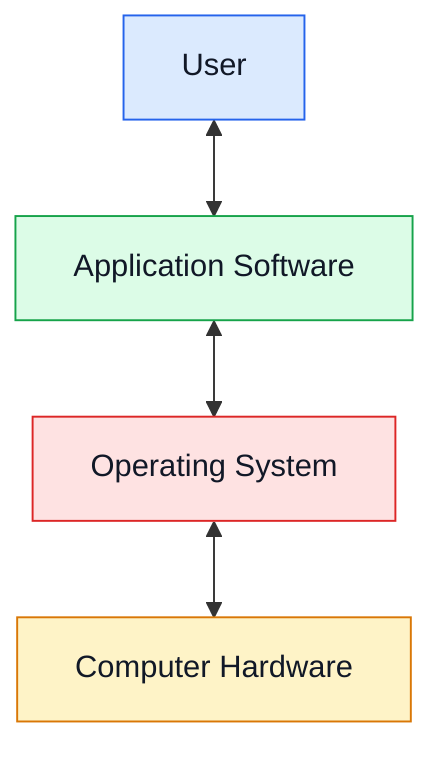

### বাংলা ব্যাখ্যা

Operating System হলো ব্যবহারকারী, সফটওয়্যার ও হার্ডওয়্যারের মধ্যে সমন্বয়কারী সিস্টেম সফটওয়্যার। এটি CPU, RAM, ফাইল ও ডিভাইস পরিচালনা করে। যেমন Windows-এর সাহায্যে আমরা কম্পিউটারে বিভিন্ন প্রোগ্রাম চালাতে পারি।

---

## Q2. Explain Interrupt in Detail.

### Exam-Ready Answer

An **interrupt** is a signal that informs the CPU that an event needs attention. The CPU temporarily stops its current task and executes a special routine called an Interrupt Service Routine (ISR).

**Types of interrupts:**

1. **Hardware Interrupt:** Generated by hardware devices, such as a keyboard or timer.
2. **Software Interrupt:** Generated by software to request a service or perform a special operation.
3. **Exception:** Generated by an event during instruction execution, such as division by zero. It is often handled similarly to an interrupt.

**Working of an interrupt:**

1. An interrupt occurs.
2. The CPU saves the current execution state.
3. The CPU transfers control to the appropriate interrupt handler.
4. The handler processes the event.
5. The CPU restores the saved state and resumes execution, when appropriate.

**Advantages:**
- Improves CPU efficiency.
- Allows quick responses to external events.
- Avoids continuously checking devices.
- Supports multitasking and I/O operations.

### Diagram

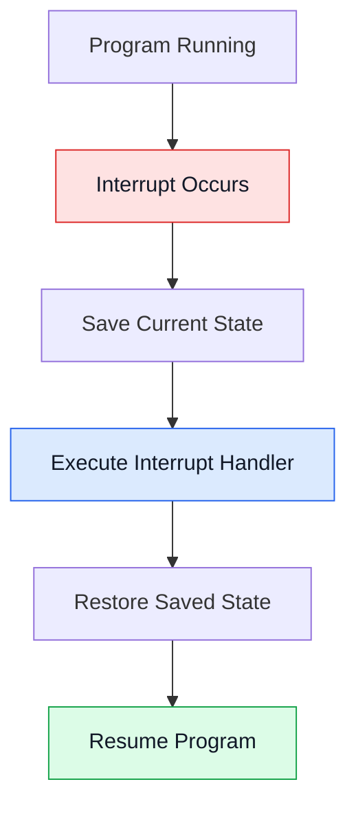

### বাংলা ব্যাখ্যা

Interrupt হলো CPU-কে কোনো জরুরি ঘটনা সম্পর্কে জানানোর সংকেত। যেমন কিবোর্ডে কোনো কী চাপলে CPU সেই ঘটনার জন্য প্রয়োজনীয় কাজ করতে পারে। কাজটি শেষ হলে আগের প্রোগ্রাম আবার চালু হয়।

**মনে রাখবে:** ISR-এর পূর্ণরূপ হলো Interrupt Service Routine।

---

## Q3. Explain Memory Organization / Memory Management.

### Exam-Ready Answer

**Memory management** is an important function of an Operating System. It manages main memory and allocates memory to processes when needed.

The main activities of memory management are:

1. Keeping track of used and free memory.
2. Allocating memory to processes.
3. Deallocating memory when processes finish.
4. Protecting the memory of different processes.
5. Supporting virtual memory when required.

**Memory organization** can be understood through the memory hierarchy, arranged from the fastest to the slowest storage.

### Memory Hierarchy

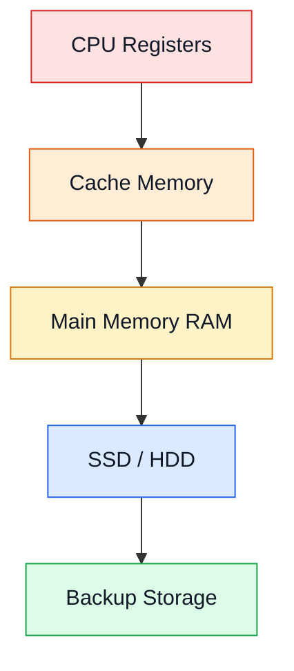

- Registers are the fastest and smallest.
- Cache stores frequently needed data.
- RAM stores programs and data currently in use.
- SSD/HDD stores data for long-term use.

### বাংলা ব্যাখ্যা

Memory Management হলো RAM-এর ব্যবহার নিয়ন্ত্রণ করার কাজ। কোন প্রোগ্রাম কতটুকু মেমোরি পাবে, কোন জায়গা খালি আছে এবং কাজ শেষ হলে কীভাবে মেমোরি মুক্ত হবে—এসব OS পরিচালনা করে।

Memory Hierarchy-তে সাধারণত উপরের স্তর দ্রুত, ছোট এবং প্রতি বিটে বেশি ব্যয়বহুল হয়। নিচের স্তরগুলো তুলনামূলক ধীর, তবে বেশি ডেটা সংরক্ষণ করতে পারে।

**মনে রাখবে:** RAM হলো main memory; SSD/HDD হলো secondary storage।

---

## Q4. Explain Computer-System Architecture.

### Exam-Ready Answer

Computer-system architecture describes how processors, memory, and I/O devices are organized and connected in a computer system.

The major types are:

**1. Single-Processor System:**
It has one main general-purpose CPU. It can run many programs by switching between them.

**2. Multiprocessor System:**
It has two or more processors or CPU cores that can execute tasks in parallel.

**3. Multicore System:**
It has multiple processing cores on a single processor chip.

**4. Clustered System:**
It consists of multiple independent computers connected to work together. It can provide high availability and improved performance.

### Diagram

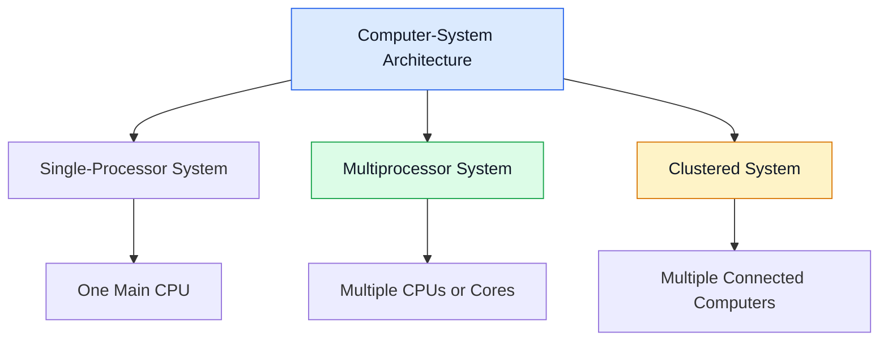

### বাংলা ব্যাখ্যা

Computer-System Architecture বলতে কম্পিউটারের CPU, মেমোরি এবং অন্যান্য অংশ কীভাবে সাজানো ও সংযুক্ত থাকে, তা বোঝায়।

Single-processor সিস্টেমে একটি প্রধান CPU থাকে। Multiprocessor বা Multicore সিস্টেমে একাধিক প্রসেসিং ইউনিটের সাহায্যে একাধিক কাজ সমান্তরালে করা যায়। Clustered system-এ একাধিক কম্পিউটার একসঙ্গে কাজ করে।

---

## Q5. What Is Multiprogramming? Explain Its Advantages.

### Exam-Ready Answer

**Multiprogramming** is an operating-system technique in which several programs are kept in main memory at the same time. When one program waits for an I/O operation, the CPU can execute another ready program.

### Working Diagram

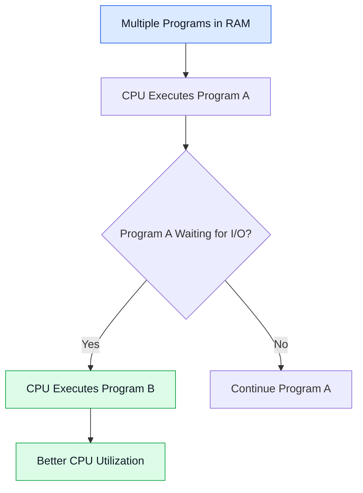

**Advantages:**

1. Increases CPU utilization.
2. Reduces CPU idle time.
3. Improves system throughput.
4. Allows multiple programs to stay in memory.
5. Makes better use of system resources.

**Example:** While one program waits for data from a disk, the CPU executes another program.

### বাংলা ব্যাখ্যা

Multiprogramming-এ একাধিক প্রোগ্রাম একই সময়ে RAM-এ থাকে। একটি প্রোগ্রাম I/O-এর জন্য অপেক্ষা করলে CPU অন্য একটি প্রস্তুত প্রোগ্রাম চালায়। এতে CPU বসে থাকে না এবং কাজের দক্ষতা বাড়ে।

**মনে রাখবে:** একাধিক প্রোগ্রাম মেমোরিতে থাকা মানেই একাধিক CPU-তে একসঙ্গে চলা নয়।

---

## Q6. What Is Multiprocessing? Explain Its Advantages.

### Exam-Ready Answer

**Multiprocessing** is a computer-system technique that uses two or more processors or processing cores to execute tasks.

In a multiprocessing system, different processes or threads can run in parallel on different processing units.

**Advantages:**

1. Improves system performance.
2. Allows parallel execution of tasks.
3. Increases throughput.
4. Can improve reliability.
5. Makes better use of available processing resources.

**Example:** In a quad-core computer, different CPU cores can execute different threads at the same time.

### Diagram

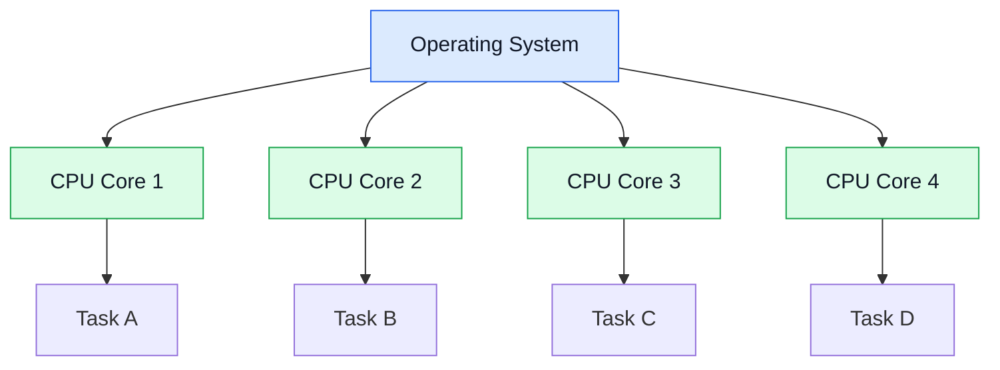

### বাংলা ব্যাখ্যা

Multiprocessing-এ দুই বা ততোধিক প্রসেসর বা CPU core ব্যবহার করা হয়। ফলে বিভিন্ন কাজ একই সময়ে সমান্তরালে চলতে পারে। এটি পারফরম্যান্স ও Throughput বাড়াতে সাহায্য করে।

---

## Q7. Differentiate Between Multiprogramming and Multiprocessing.

### Exam-Ready Answer

| Multiprogramming | Multiprocessing |
|---|---|
| Multiple programs are kept in memory. | Multiple processors or cores are used. |
| The main goal is to improve CPU utilization. | The main goal is to support parallel execution and improve performance. |
| A single CPU can be used. | Two or more processing units are used. |
| The CPU switches between programs when needed. | Different tasks can run on different cores simultaneously. |
| It reduces CPU idle time. | It can increase throughput and processing speed. |

### বাংলা ব্যাখ্যা

Multiprogramming-এ একাধিক প্রোগ্রাম RAM-এ রাখা হয়, যাতে একটি অপেক্ষা করলে CPU অন্যটি চালাতে পারে। Multiprocessing-এ একাধিক CPU বা core ব্যবহার করে বিভিন্ন কাজ সত্যিকার অর্থে সমান্তরালে চালানো যায়।

**পরীক্ষায় গুরুত্বপূর্ণ:** Multiprogramming-এর মূল লক্ষ্য CPU utilization বাড়ানো; Multiprocessing-এর বড় সুবিধা হলো parallel execution।

---

## Q8. Explain a Dual-Core Design.

### Exam-Ready Answer

A **dual-core processor** is a single physical processor chip that contains two independent processing cores.

Each core can execute instructions independently. The cores may share resources such as the main memory and some levels of cache.

**Main features:**

1. Contains two processing cores on one chip.
2. Supports parallel execution of tasks or threads.
3. Can improve multitasking performance.
4. Shares some system resources.
5. Performance depends on the software and workload.

### Diagram

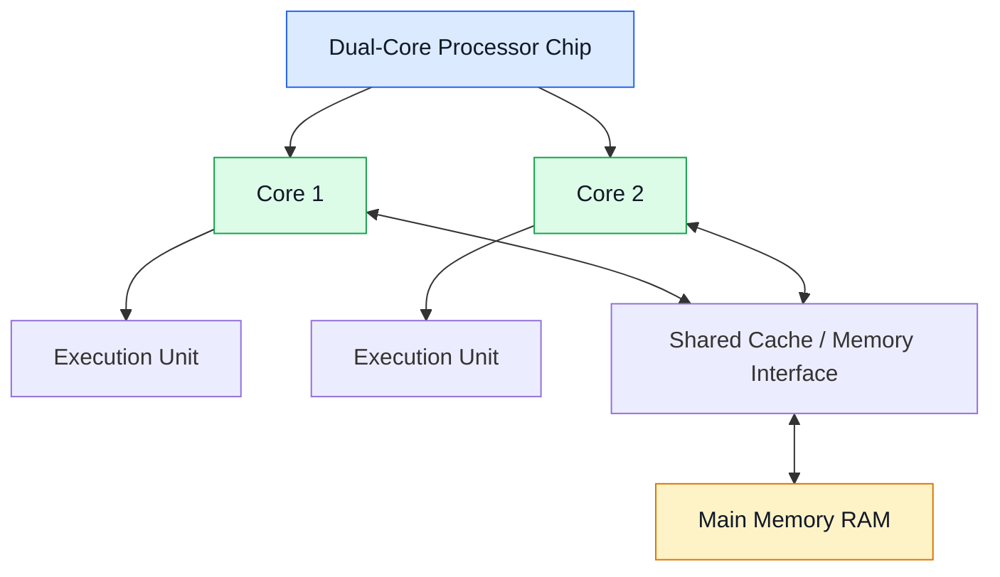

### বাংলা ব্যাখ্যা

Dual-Core processor-এর একটি চিপের মধ্যে দুটি processing core থাকে। প্রতিটি core আলাদাভাবে নির্দেশনা চালাতে পারে। যেমন একটি core-এ একটি কাজ এবং অন্য core-এ অন্য কাজ চলতে পারে।

এখানে **দুটি core মানে দুটি আলাদা physical processor chip নয়**। দুটি core একই চিপের অংশ।

---

## Q9. What Is Process Management? Explain the Activities of Process Management.

### Exam-Ready Answer

**Process management** is an important function of an Operating System that manages processes during their lifetime.

A process is a program in execution.

The main activities of process management are:

1. Creating and terminating processes.
2. Suspending and resuming processes.
3. Scheduling processes for CPU execution.
4. Providing process synchronization.
5. Supporting communication between processes.
6. Handling deadlocks.

### Diagram

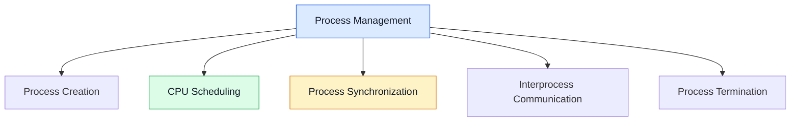

### বাংলা ব্যাখ্যা

Process Management হলো OS-এর মাধ্যমে চলমান প্রোগ্রামগুলোর জীবনচক্র পরিচালনা করা। OS নতুন process তৈরি করে, CPU-তে চালানোর জন্য নির্বাচন করে, বিভিন্ন process-এর যোগাযোগ ও synchronization পরিচালনা করে এবং কাজ শেষ হলে process বন্ধ করে।

---

## Q10. What Is Storage Management? Explain the Activities of Storage Management.

### Exam-Ready Answer

**Storage management** is an operating-system function that manages data storage and helps programs store and access data efficiently.

The main activities include:

1. **File-System Management:** Creates, deletes, reads, and organizes files and directories.
2. **Secondary-Storage Management:** Manages storage devices such as SSDs and HDDs.
3. **Free-Space Management:** Keeps track of available storage space.
4. **Storage Allocation:** Allocates storage space to files.
5. **Disk Scheduling:** Determines the order of disk I/O requests when applicable.
6. **Protection:** Controls access to stored data.

### Diagram

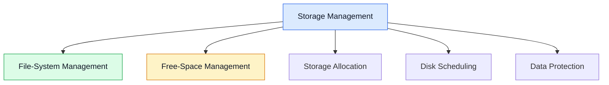

### বাংলা ব্যাখ্যা

Storage Management হলো ডেটা সংরক্ষণ ও ব্যবহারের ব্যবস্থা পরিচালনা করা। OS ফাইল কোথায় রাখা হবে, কতটুকু জায়গা খালি আছে, কোন ডেটা কীভাবে পড়া হবে এবং কারা ডেটা ব্যবহার করতে পারবে—এসব কাজে সাহায্য করে।

**মনে রাখবে:** RAM হলো main memory; SSD/HDD হলো secondary storage। Storage management মূলত দীর্ঘমেয়াদি ডেটা সংরক্ষণের ব্যবস্থার সঙ্গে সম্পর্কিত।

---

## Q11. Explain Kernel Data Structures in Operating Systems.

### Exam-Ready Answer

Kernel data structures are data structures used by the OS kernel to organize and manage system information and resources.

Important kernel data structures include:

1. **Lists:** Store collections of related items, such as process entries.
2. **Queues:** Manage items in a specific order, such as scheduling queues.
3. **Stacks:** Store temporary information during function calls and interrupt handling.
4. **Trees:** Organize hierarchical information.
5. **Hash Tables:** Provide fast lookup of information using keys.
6. **Bitmaps:** Track the status of resources, such as free or allocated memory blocks.

These structures help the kernel manage processes, memory, files, and devices efficiently.

### Diagram

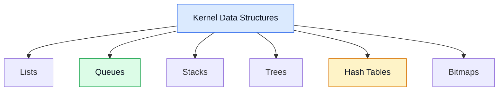

### বাংলা ব্যাখ্যা

Kernel Data Structures হলো OS-এর ভেতরে তথ্য সাজিয়ে রাখার পদ্ধতি। যেমন Ready Queue-তে CPU-এর জন্য অপেক্ষা করা process রাখা হয়। Bitmap দিয়ে কোনো resource ব্যবহার হচ্ছে কি না তা বোঝা যেতে পারে। Hash Table দ্রুত তথ্য খুঁজে পেতে সাহায্য করে।

**মনে রাখবে:** সব Operating System একই data structure একইভাবে ব্যবহার করে না।

---

## Q12. Explain Process State.

### Exam-Ready Answer

A **process state** represents the current condition of a process during its execution.

The five common process states are:

1. **New:** The process is being created.
2. **Ready:** The process is waiting for CPU allocation.
3. **Running:** The CPU is executing the process.
4. **Waiting (Blocked):** The process is waiting for an event, such as I/O completion.
5. **Terminated:** The process has finished execution.

### Process-State Diagram

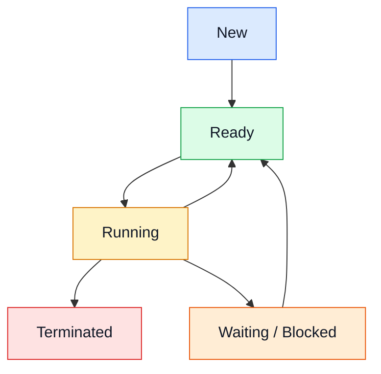

### বাংলা ব্যাখ্যা

একটি process চলার সময় বিভিন্ন state-এ যেতে পারে।

- New: নতুন process তৈরি হচ্ছে।
- Ready: CPU পাওয়ার অপেক্ষায়।
- Running: CPU-তে চলছে।
- Waiting: I/O বা অন্য কোনো event-এর অপেক্ষায়।
- Terminated: কাজ শেষ।

Running process I/O-এর জন্য অপেক্ষা করলে Waiting state-এ যায়। অপেক্ষা শেষ হলে আবার Ready state-এ ফিরে আসে।

---

## Q13. What Is a Process Control Block (PCB)?

### Exam-Ready Answer

A **Process Control Block (PCB)** is a data structure maintained by the Operating System to store important information about a process.

The main contents of a PCB are:

1. **Process ID:** A unique identifier of the process.
2. **Process State:** The current state of the process.
3. **Program Counter:** The address of the next instruction.
4. **CPU Registers:** The saved values of CPU registers.
5. **CPU Scheduling Information:** Priority and other scheduling details.
6. **Memory-Management Information:** Information about the process's memory.
7. **I/O Status Information:** Information about allocated devices and open files.
8. **Accounting Information:** Information such as CPU usage.

The OS uses the PCB to manage processes and perform context switching.

### Diagram

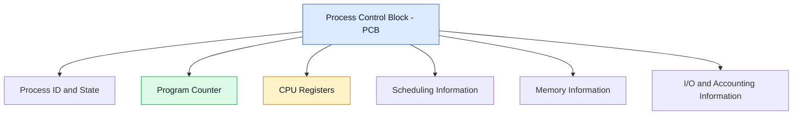

### বাংলা ব্যাখ্যা

PCB-কে একটি process-এর তথ্য রাখার রেকর্ড হিসেবে ভাবতে পারো। এতে process-এর ID, বর্তমান অবস্থা, CPU register-এর মান এবং অন্যান্য প্রয়োজনীয় তথ্য থাকে।

Context switch-এর সময় OS চলমান process-এর প্রয়োজনীয় অবস্থা সংরক্ষণ করে এবং পরবর্তী process-এর সংরক্ষিত অবস্থা পুনরুদ্ধার করে।

**মনে রাখবে:** PCB-এর পূর্ণরূপ Process Control Block।

---

## Q14. What Is Multitasking?

### Exam-Ready Answer

**Multitasking** is an operating-system technique that allows multiple tasks or programs to make progress during the same period.

In a single-core system, the OS rapidly switches the CPU between tasks. This creates the appearance that multiple tasks are running at the same time. On a multicore system, some tasks can also execute in parallel.

**Types of multitasking:**

1. **Preemptive Multitasking:** The OS can interrupt a running task and give the CPU to another task.
2. **Cooperative Multitasking:** A task voluntarily gives up control so another task can run.

**Advantages:**
- Improves system responsiveness.
- Allows users to work with multiple applications.
- Makes efficient use of CPU time.

**Example:** Listening to music while browsing the internet and downloading a file.

### Diagram

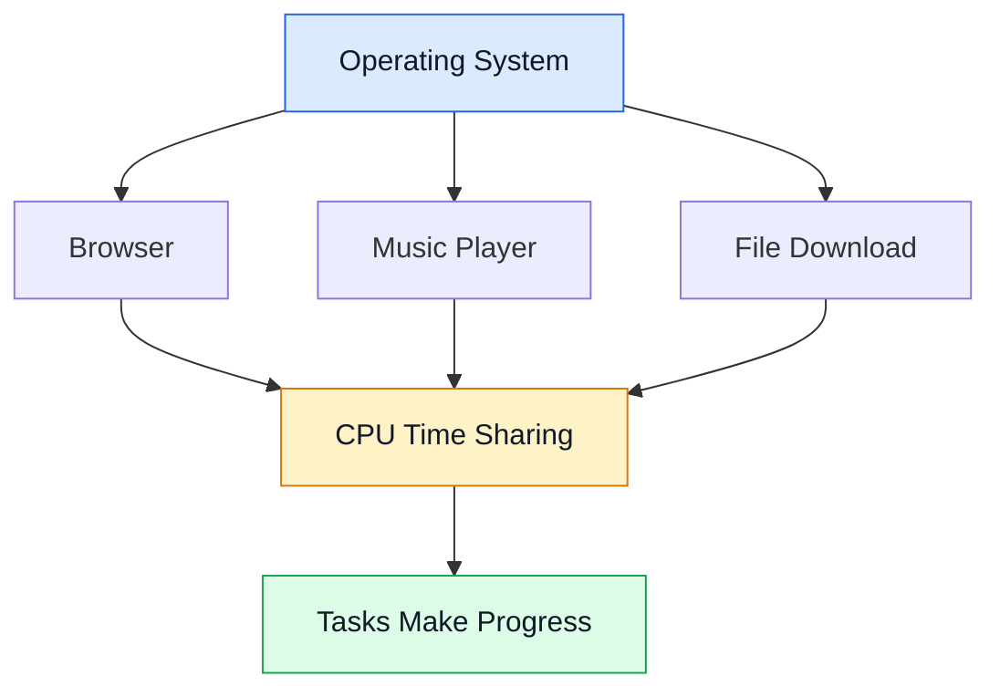

### বাংলা ব্যাখ্যা

Multitasking-এর মাধ্যমে একাধিক কাজ একই সময়ে চলমান বলে মনে হয়। Single-core CPU দ্রুত এক কাজ থেকে অন্য কাজে সুইচ করে। Multicore CPU হলে কিছু কাজ সত্যিকার অর্থেই সমান্তরালে চলতে পারে।

যেমন গান শোনার পাশাপাশি ব্রাউজিং করা এবং ফাইল ডাউনলোড করা।

---

## Q15. What Is a Thread? Explain Threads in an Operating System.

### Exam-Ready Answer

A **thread** is the smallest unit of CPU execution within a process. A process may contain one or more threads.

Threads of the same process share code, data, and many process resources. However, each thread has its own program counter, registers, and stack.

**Advantages of threads:**

1. Improve application responsiveness.
2. Allow concurrent execution.
3. Share data easily within the same process.
4. Usually require fewer resources than separate processes.
5. Can improve performance on multicore processors.

**Example:** A web browser may use different threads for handling user actions, network operations, and background work.

### Diagram

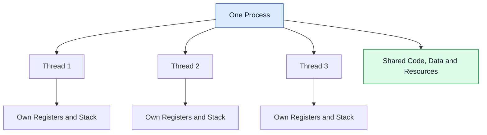

### বাংলা ব্যাখ্যা

Thread হলো একটি process-এর ভেতরে CPU execution-এর ছোট একক। একটি process-এর একাধিক thread থাকতে পারে।

একই process-এর thread-গুলো code, data ও অনেক resource শেয়ার করে। কিন্তু প্রতিটি thread-এর নিজস্ব stack, register এবং program counter থাকে।

---

## Q16. What Is Process Scheduling? Explain the Process Scheduling Queues.

### Exam-Ready Answer

**Process scheduling** is the activity of selecting processes for execution and deciding which process should use the CPU.

The main process scheduling queues are:

1. **Job Queue:** Contains processes submitted to the system.
2. **Ready Queue:** Contains processes in main memory that are ready to use the CPU.
3. **Device Queue:** Contains processes waiting for a particular I/O device or operation.

A process can move between these queues during its lifetime.

### Diagram

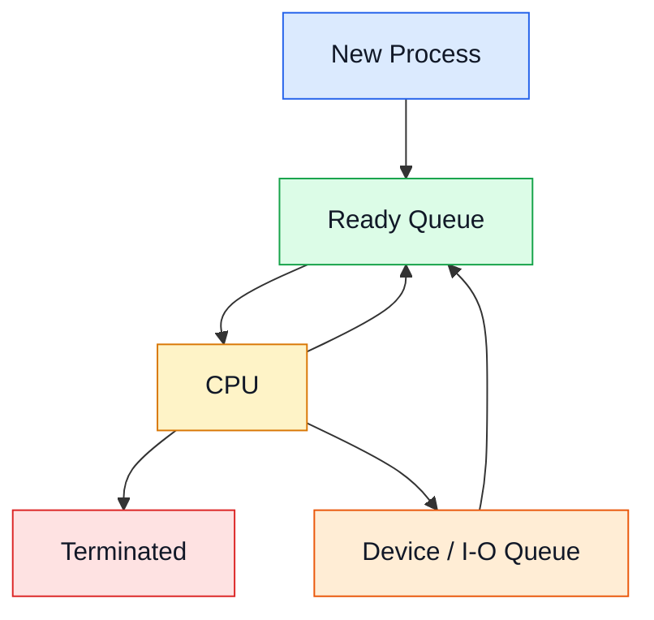

### বাংলা ব্যাখ্যা

Process Scheduling-এর মাধ্যমে OS ঠিক করে কোন process কখন CPU ব্যবহার করবে।

- Job Queue: সিস্টেমে আসা process-এর তালিকা।
- Ready Queue: CPU পাওয়ার জন্য প্রস্তুত process-এর তালিকা।
- Device Queue: I/O operation-এর জন্য অপেক্ষমাণ process-এর তালিকা।

কোনো process CPU ব্যবহার করার পর I/O চাইলে Device Queue-তে যেতে পারে। I/O শেষ হলে আবার Ready Queue-তে ফিরে আসে।

---

## Q17. Explain Schedulers in an Operating System.

### Exam-Ready Answer

A **scheduler** is an operating-system component that selects processes for admission, execution, or temporary removal from memory.

There are three main types of schedulers:

**1. Long-Term Scheduler (Job Scheduler):**
Selects processes from the job pool and admits them into main memory. It controls the degree of multiprogramming.

**2. Short-Term Scheduler (CPU Scheduler):**
Selects a process from the ready queue and allocates the CPU to it. It runs very frequently.

**3. Medium-Term Scheduler:**
Temporarily removes processes from memory and later brings them back. This is called swapping.

### Comparison Table

| Scheduler | Main Function | Frequency |
|---|---|---|
| Long-Term | Admits jobs into memory | Less frequent |
| Short-Term | Selects a process for the CPU | Very frequent |
| Medium-Term | Swaps processes out and in | As needed |

### Diagram

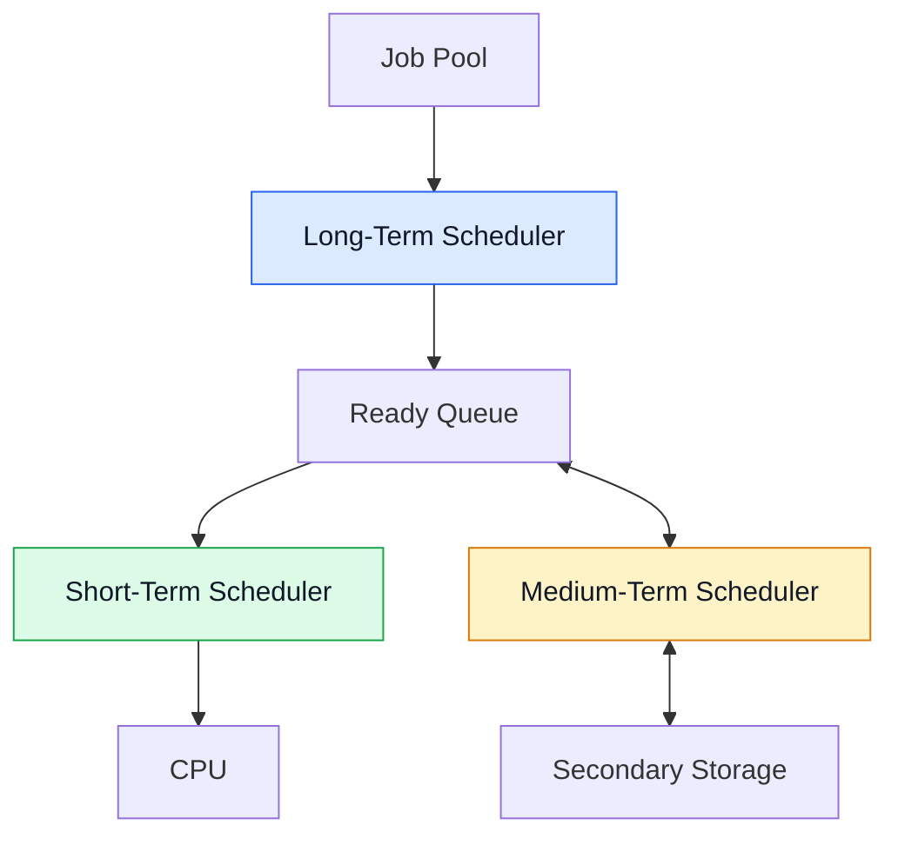

### বাংলা ব্যাখ্যা

Scheduler মূলত process নির্বাচন করে।

- Long-Term Scheduler ঠিক করে কোন job মেমোরিতে প্রবেশ করবে।
- Short-Term Scheduler Ready Queue থেকে CPU-এর জন্য process নির্বাচন করে।
- Medium-Term Scheduler প্রয়োজন হলে process-কে সাময়িকভাবে মেমোরি থেকে সরিয়ে পরে আবার ফিরিয়ে আনে।

**পরীক্ষার গুরুত্বপূর্ণ পার্থক্য:** Short-Term Scheduler সবচেয়ে ঘন ঘন কাজ করে।

---

## Q18. Explain Multiprocess Architecture in the Google Chrome Browser.

### Exam-Ready Answer

Google Chrome uses a **multiprocess architecture** to improve stability, security, and responsiveness.

Its main process types include:

1. **Browser Process:** Manages the browser window, tabs, navigation, and other browser-level tasks.
2. **Renderer Process:** Processes web-page content and renders pages. Chrome may use separate renderer processes for different sites or groups of pages.
3. **GPU Process:** Handles graphics-related tasks.
4. **Utility Processes:** Handle services such as network operations, audio, and other supporting functions.

**Advantages:**

- Improves stability because a renderer failure may affect only some pages.
- Provides better isolation between websites.
- Improves security by using process isolation and sandboxing.
- Allows different browser tasks to work independently.

### Diagram

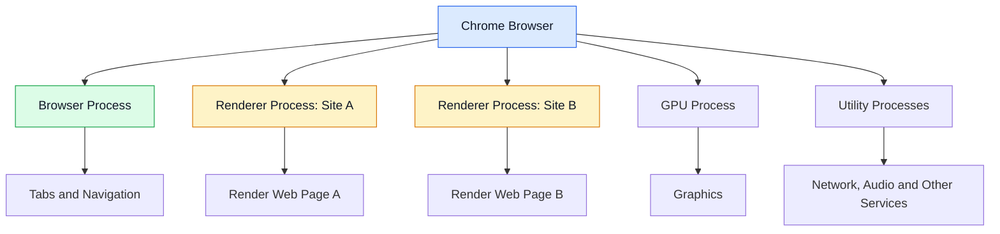

### বাংলা ব্যাখ্যা

Chrome শুধু একটি process দিয়ে সব কাজ না করে বিভিন্ন কাজের জন্য একাধিক process ব্যবহার করে।

Browser Process ব্রাউজারের মূল কাজ নিয়ন্ত্রণ করে। Renderer Process ওয়েবপেজ তৈরি ও প্রদর্শন করে। GPU Process গ্রাফিক্সের কাজ করে এবং Utility Process বিভিন্ন সহায়ক কাজ পরিচালনা করে।

একটি renderer process crash করলে সব সময় পুরো ব্রাউজার বন্ধ হয়ে যায় না। তবে সব tab-এর জন্য আলাদা process থাকবে—এমন নিশ্চয়তা নেই; Chrome-এর process allocation পরিস্থিতি অনুযায়ী বদলাতে পারে।

---

## Q19. What Is Message Passing?

### Exam-Ready Answer

**Message passing** is an interprocess communication (IPC) method in which processes exchange data by sending and receiving messages.

The two basic operations are:

1. **Send:** A process sends a message.
2. **Receive:** Another process receives the message.

Message passing can be direct, where processes communicate with each other by name, or indirect, where they communicate through a mailbox or message queue.

**Advantages:**

- Supports communication between processes.
- Helps processes exchange information.
- Can support synchronization.
- Allows communication between processes with separate address spaces.

**Example:** A client sends a request message to a server, and the server sends back a response.

### Diagram


### বাংলা ব্যাখ্যা

Message Passing হলো এক process থেকে অন্য process-এ message পাঠিয়ে তথ্য আদান-প্রদান করার পদ্ধতি।

যেমন Client কোনো সার্ভারকে request পাঠায়। Server request গ্রহণ করে কাজ সম্পন্ন করে response পাঠায়। এভাবে process-গুলো যোগাযোগ করতে পারে।

---

## Q20. Explain Synchronization in an Operating System.

### Exam-Ready Answer

**Process synchronization** is the coordination of multiple processes or threads that share data or resources. It helps prevent race conditions and keeps shared data consistent.

Important concepts include:

1. **Critical Section:** The part of a program where shared data or resources are accessed.
2. **Race Condition:** Occurs when the result depends on the unpredictable order of concurrent operations.
3. **Mutex:** A locking mechanism that allows only one thread at a time to enter a protected section.
4. **Semaphore:** A synchronization tool that controls access to shared resources.

A correct critical-section solution should provide mutual exclusion, progress, and bounded waiting under the standard critical-section requirements.

**Example:** If two threads update the same bank balance at the same time without proper synchronization, the final balance may be incorrect.

### Diagram

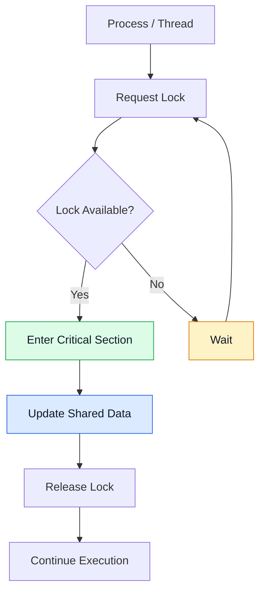

### বাংলা ব্যাখ্যা

একাধিক process বা thread একই data ব্যবহার করলে সঠিক ফল নিশ্চিত করতে synchronization দরকার।

যেমন একই ব্যাংক অ্যাকাউন্টে দুটি transaction একসঙ্গে balance পরিবর্তন করলে সমস্যা হতে পারে। Mutex বা Semaphore-এর সাহায্যে shared resource নিয়ন্ত্রিতভাবে ব্যবহার করানো যায়।

**মনে রাখবে:** Synchronization মানে শুধু একসঙ্গে কাজ বন্ধ করা নয়; সঠিক ক্রম ও shared data-এর consistency নিশ্চিত করাও এর উদ্দেশ্য।

---

## Q21. What Is a Socket? Explain Sockets in an Operating System.

### Exam-Ready Answer

A **socket** is a communication endpoint used by processes to exchange data. It is commonly used for communication between applications over a network.

A network socket is commonly identified by an IP address, a port number, and a transport protocol.

**Types of network sockets:**

1. **Stream Socket:** Commonly uses TCP and provides reliable, ordered byte-stream communication.
2. **Datagram Socket:** Commonly uses UDP and sends separate datagrams without guaranteeing delivery or order.

**Working of a socket:**

1. A server creates a socket and binds it to an address and port.
2. A TCP server listens for connections and accepts a client.
3. The client connects to the server.
4. Both sides exchange data.
5. The connection is closed when communication ends.

### Diagram

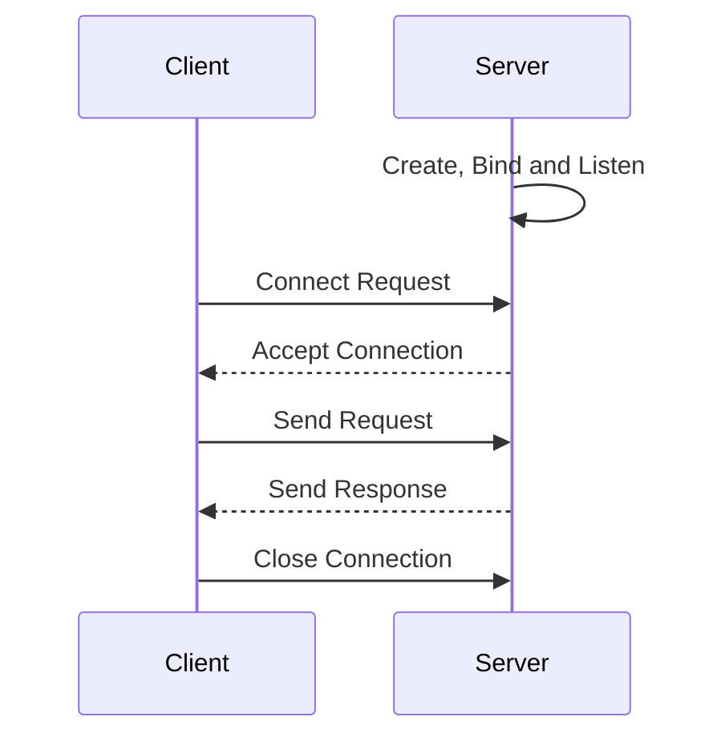

### বাংলা ব্যাখ্যা

Socket হলো দুইটি প্রোগ্রামের মধ্যে যোগাযোগের একটি endpoint। যেমন তোমার ব্রাউজার কোনো ওয়েব সার্ভারে request পাঠাতে socket ব্যবহার করতে পারে।

TCP সাধারণত নির্ভরযোগ্য ও ক্রমানুসারে byte পাঠায়। UDP datagram পাঠায়, কিন্তু delivery বা order নিশ্চিত করে না।

**মনে রাখবে:** IP address ডিভাইস বা নেটওয়ার্ক ইন্টারফেসকে শনাক্ত করতে সাহায্য করে; port number নির্দিষ্ট application/service-এর endpoint চিহ্নিত করতে সাহায্য করে।

---

## Q22. Differentiate Between Process and Thread.

### Exam-Ready Answer

A process is a program in execution, while a thread is a unit of CPU execution within a process.

| Process | Thread |
|---|---|
| A process is an executing program. | A thread is an execution unit within a process. |
| Processes usually have separate address spaces. | Threads of the same process share the process address space. |
| A process has its own process resources. | Threads share many process resources. |
| Process creation usually has more overhead. | Thread creation usually has less overhead. |
| Communication between processes may require IPC. | Threads can communicate through shared memory within their process. |
| A process failure is often isolated from other processes. | A faulty thread can affect the entire process. |

### Diagram

```mermaid
flowchart TD
    A[Operating System]
    A --> B[Process A]
    A --> C[Process B]
    B --> D[Thread 1]
    B --> E[Thread 2]
    B --> F[Shared Code and Data]
    C --> G[Thread 1]
    C --> H[Thread 2]
    style B fill:#dbeafe,stroke:#2563eb,color:#111827
    style C fill:#fef3c7,stroke:#d97706,color:#111827
    style F fill:#dcfce7,stroke:#16a34a,color:#111827
```

### বাংলা ব্যাখ্যা

Process হলো চলমান প্রোগ্রাম, আর Thread হলো সেই process-এর ভেতরে execution-এর একক।

দুটি আলাদা process সাধারণত আলাদা address space ব্যবহার করে। একই process-এর thread-গুলো code, data এবং অনেক resource শেয়ার করে, তবে প্রতিটি thread-এর নিজস্ব stack, register ও program counter থাকে।

---

# QUICK REVISION — IMPORTANT DIFFERENCES

## 1. Multiprogramming vs Multiprocessing vs Multitasking

| Topic | Main Idea |
|---|---|
| Multiprogramming | Several programs stay in memory to improve CPU utilization. |
| Multiprocessing | Two or more processors or cores can execute tasks in parallel. |
| Multitasking | Multiple tasks make progress during the same period through CPU scheduling and/or parallel execution. |

## 2. Process States

| State | Meaning |
|---|---|
| New | Process is being created. |
| Ready | Waiting for CPU allocation. |
| Running | Executing on the CPU. |
| Waiting | Waiting for an event or I/O. |
| Terminated | Execution has finished. |

## 3. Three Schedulers

| Scheduler | Remember |
|---|---|
| Long-Term | Admits jobs into memory. |
| Short-Term | Selects the next process for the CPU. |
| Medium-Term | Swaps processes out of and back into memory. |

## 4. Process vs Thread

- **Process:** An executing program with its own address space.
- **Thread:** An execution unit within a process.
- Threads in the same process share many resources.
- Each thread has its own stack and CPU execution context.

## 5. Essential Full Forms

| Short Form | Full Form |
|---|---|
| OS | Operating System |
| CPU | Central Processing Unit |
| RAM | Random Access Memory |
| PCB | Process Control Block |
| ISR | Interrupt Service Routine |
| IPC | Interprocess Communication |
| I/O | Input/Output |
| GPU | Graphics Processing Unit |
| TCP | Transmission Control Protocol |
| UDP | User Datagram Protocol |

---

# EXAM WRITING TIPS

1. Start with a clear definition.
2. Write 4–6 important points for a 5-mark answer.
3. Use a table when the question asks to differentiate.
4. Draw a labelled diagram for process states, scheduling, memory hierarchy, dual-core design, and Chrome architecture when relevant.
5. Write a short example when it helps explain the concept.
6. Underline keywords such as **CPU Utilization**, **PCB**, **Kernel**, **Interrupt**, and **Synchronization**.
7. Keep the answer relevant to the question and leave enough time for all answers.

---

# REFERENCES FOR REVISION

- [OpenStax — Fundamental OS Concepts](https://openstax.org/books/introduction-computer-science/pages/6-2-fundamental-os-concepts)
- [OpenStax — Processes and Concurrency](https://openstax.org/books/introduction-computer-science/pages/6-3-processes-and-concurrency)
- [Operating System — Process Concepts](https://ebooks.inflibnet.ac.in/csp3/chapter/process-concepts/)

**End of Operating System Mid Exam Notes**
