# Operating System — Mid Exam Notes
### বাংলা ব্যাখ্যা আগে • Simple English Answer পরে • Standard-style diagrams


---

## Q1. What are the main functions of an Operating System?

### বাংলা ব্যাখ্যা
Operating System (OS) হলো ব্যবহারকারী/অ্যাপ্লিকেশন এবং কম্পিউটারের হার্ডওয়্যারের মাঝের ব্যবস্থাপক। যেমন Windows, Linux, Android। কোনো প্রোগ্রাম CPU চাইলে, ফাইল খুলতে চাইলে বা মেমোরি ব্যবহার করতে চাইলে OS সেই কাজগুলো পরিচালনা করে।

### Exam-Ready Answer
An **Operating System (OS)** is system software that acts as an interface between users, applications, and computer hardware. Its main functions are:

1. **Process management:** Creates, schedules, and terminates processes.
2. **Memory management:** Allocates and frees main memory.
3. **File management:** Creates, organizes, reads, and deletes files.
4. **Device management:** Controls input and output devices.
5. **Security and protection:** Prevents unauthorized access.
6. **User interface:** Provides a command-line or graphical interface.
7. **Resource allocation:** Shares CPU, memory, and devices among programs.

**Example:** When a user opens a browser, the OS allocates memory, schedules CPU time, and manages network and display devices.

### Diagram: OS as an interface
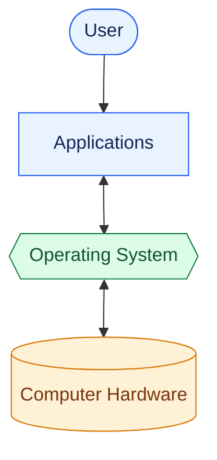

---

## Q2. Explain interrupts in detail.

### বাংলা ব্যাখ্যা
Interrupt হলো CPU-কে জানানো একটি সংকেত যে কোনো জরুরি ঘটনা ঘটেছে বা কোনো ডিভাইসের মনোযোগ দরকার। উদাহরণ: keyboard-এ key চাপা বা disk-এর কাজ শেষ হওয়া। CPU সাধারণত বর্তমান নির্দেশনা শেষ করে, চলমান কাজের অবস্থা সংরক্ষণ করে, interrupt handler চালায়, তারপর আগের কাজে ফিরে আসে।

### Exam-Ready Answer
An **interrupt** is a signal that requests the CPU's attention and causes it to temporarily pause its current work to handle an event.

**Working steps:**
1. A hardware device or software generates an interrupt.
2. The CPU completes the current instruction and saves the necessary state.
3. The CPU identifies the appropriate **Interrupt Service Routine (ISR)**.
4. The ISR handles the event.
5. The CPU restores the saved state and resumes the interrupted program.

**Types of interrupts:**
- **Hardware interrupt:** Generated by devices such as a keyboard, timer, or disk.
- **Software interrupt / trap:** Generated by a program or by a system-call mechanism.
- **Exception:** Caused by conditions such as division by zero or an invalid instruction.

**Importance:** Interrupts let the CPU respond to events efficiently without continuously checking every device.

### Diagram: Interrupt handling
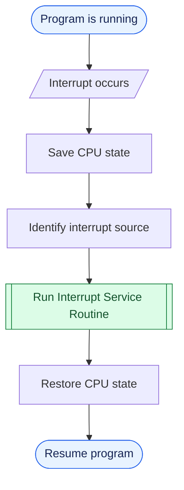

---

## Q3. Explain memory organization and memory management.

### বাংলা ব্যাখ্যা
কম্পিউটারে মেমোরির স্তর আছে। CPU-এর ভেতরের registers খুব দ্রুত, cache দ্রুত, RAM-এ চলমান প্রোগ্রাম ও ডেটা থাকে, আর SSD/HDD-তে দীর্ঘমেয়াদে ডেটা থাকে। OS RAM-এ কোন প্রোগ্রাম কত জায়গা পাবে, কোন জায়গা ফাঁকা হবে এবং দরকার হলে disk থেকে data আনার ব্যবস্থা করে।

### Exam-Ready Answer
**Memory management** is the OS function responsible for tracking and controlling main memory.

Its main activities are:
1. Keeping track of which memory areas are in use and by whom.
2. Allocating memory to processes when needed.
3. Deallocating memory when processes finish.
4. Protecting one process's memory from unauthorized access by another.
5. Supporting virtual memory, which allows programs to use more memory than the available physical RAM.

A simplified memory hierarchy is shown below. Moving upward generally means faster, smaller, and more expensive storage per byte.


## Memory Hierarchy

### বাংলা ব্যাখ্যা
কম্পিউটারের memory ও storage বিভিন্ন স্তরে সাজানো থাকে। উপরের স্তরগুলো সাধারণত দ্রুত কাজ করে, কিন্তু ধারণক্ষমতা কম। নিচের স্তরগুলোতে বেশি data রাখা যায়, তবে access করতে সাধারণত বেশি সময় লাগে।

### Diagram: Memory Hierarchy Pyramid

<svg xmlns="http://www.w3.org/2000/svg" width="100%" viewBox="0 0 720 390" role="img" aria-label="Memory hierarchy pyramid">
  <style>
    .label { font-family: Arial, sans-serif; font-size: 14px; font-weight: 600; text-anchor: middle; fill: #172554; }
    .category { font-family: Arial, sans-serif; font-size: 13px; fill: #334155; }
    .bracket { fill: none; stroke: #64748b; stroke-width: 2; }
  </style>

  <text x="250" y="22" text-anchor="middle" font-family="Arial, sans-serif" font-size="17" font-weight="bold" fill="currentColor">Memory Hierarchy</text>

  <!-- Level 1: Registers -->
  <rect x="190" y="35" width="120" height="35" rx="3" fill="#bbf7d0" stroke="#15803d" stroke-width="1.5"/>
  <text x="250" y="57" class="label">CPU Registers</text>

  <!-- Level 2: Cache -->
  <polygon points="160,78 340,78 355,123 145,123" fill="#bfdbfe" stroke="#2563eb" stroke-width="1.5"/>
  <text x="250" y="105" class="label">Cache Memory</text>

  <!-- Level 3: RAM -->
  <polygon points="145,131 355,131 390,183 110,183" fill="#fef3c7" stroke="#d97706" stroke-width="1.5"/>
  <text x="250" y="153" class="label">Main Memory (RAM)</text>
  <text x="250" y="171" text-anchor="middle" font-family="Arial, sans-serif" font-size="11" fill="#78350f">Primary Memory</text>

  <!-- Level 4: Secondary storage -->
  <polygon points="110,191 390,191 430,253 70,253" fill="#fed7aa" stroke="#ea580c" stroke-width="1.5"/>
  <text x="250" y="216" class="label">Secondary Storage</text>
  <text x="250" y="237" text-anchor="middle" font-family="Arial, sans-serif" font-size="12" fill="#7c2d12">USB / SD Card / SSD / HDD</text>

  <!-- Level 5: Tertiary storage -->
  <polygon points="70,261 430,261 475,330 25,330" fill="#e9d5ff" stroke="#9333ea" stroke-width="1.5"/>
  <text x="250" y="288" class="label">Tertiary / Offline Storage</text>
  <text x="250" y="310" text-anchor="middle" font-family="Arial, sans-serif" font-size="12" fill="#581c87">Magnetic Tape</text>

  <!-- Classification labels -->
  <path d="M 365 35 H 375 V 123 H 365" class="bracket"/>
  <text x="385" y="70" class="category">Internal</text>
  <text x="385" y="87" class="category">Storage</text>

  <path d="M 400 131 H 410 V 183 H 400" class="bracket"/>
  <text x="420" y="151" class="category">Primary</text>
  <text x="420" y="168" class="category">Memory</text>

  <path d="M 440 191 H 450 V 253 H 440" class="bracket"/>
  <text x="460" y="211" class="category">Secondary</text>
  <text x="460" y="228" class="category">Storage</text>

  <path d="M 485 261 H 495 V 330 H 485" class="bracket"/>
  <text x="505" y="287" class="category">Tertiary</text>
  <text x="505" y="304" class="category">Storage</text>

  <text x="250" y="357" text-anchor="middle" font-family="Arial, sans-serif" font-size="12" fill="currentColor">Downward: Larger capacity • Generally slower access</text>
</svg>

### Important Points

- **CPU Registers:** Very small and extremely fast storage inside the CPU.
- **Cache Memory:** Stores frequently needed data and instructions for faster access.
- **Main Memory (RAM):** Holds currently running programs and data.
- **Secondary Storage:** SSD, HDD, USB flash drive, and SD card provide long-term storage.
- **Tertiary Storage:** Magnetic tape is commonly used for backups and archival storage.

**Remember:** Moving downward in the hierarchy generally means greater capacity and slower access.

**Note:** Registers and cache are often grouped as internal/primary storage in textbook classifications. RAM is the main memory. USB, SD card, SSD, and HDD are usually classified as secondary storage; magnetic tape is commonly used as tertiary or offline storage.


**Example:** When a program opens, the OS loads its required instructions and data into RAM and keeps track of the memory assigned to it.

---

## Q4. Describe computer-system architecture.

### বাংলা ব্যাখ্যা
কম্পিউটার সিস্টেমের প্রধান অংশ হলো CPU, main memory এবং I/O device/controller। এগুলো system bus বা interconnect দিয়ে যোগাযোগ করে। CPU নির্দেশনা চালায়, RAM চলমান instruction ও data রাখে, আর I/O devices input/output ও storage-এর কাজ করে। একটি সিস্টেমে একটি CPU বা একাধিক CPU/core থাকতে পারে।

### Exam-Ready Answer
Computer-system architecture describes how the main hardware components are organized and connected.

The major components are:
1. **CPU:** Executes instructions and controls operations.
2. **Main memory:** Stores currently used programs and data.
3. **I/O devices and controllers:** Handle devices such as keyboards, displays, disks, and network adapters.
4. **System bus/interconnect:** Transfers data and control signals among components.

Common configurations include:
- **Single-processor system:** One main general-purpose processor.
- **Multiprocessor system:** Two or more processors/cores share system resources.
- **Multicore system:** Multiple processing cores are integrated into one processor chip.

### Diagram: Basic computer-system organization
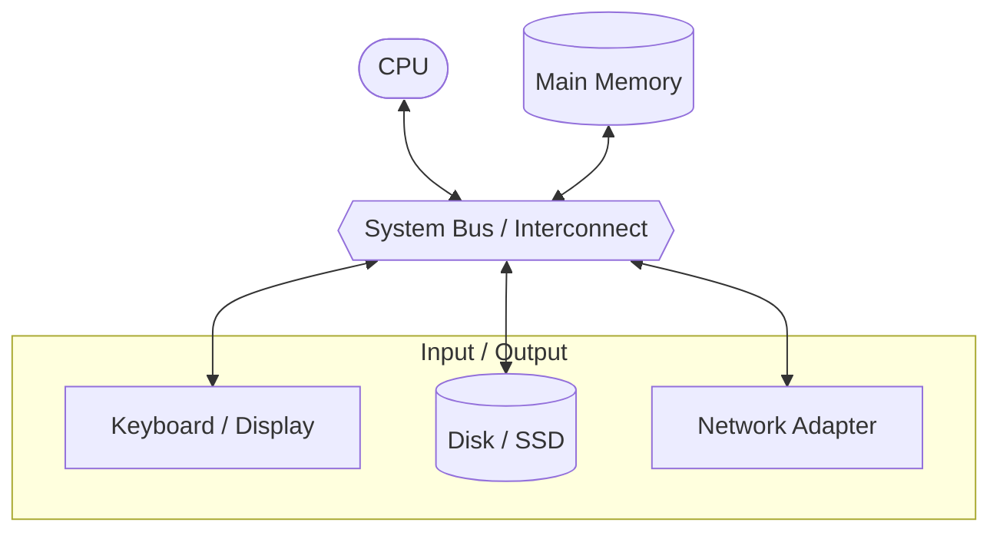

---

## Q5. What is multiprogramming? State its advantages.

### বাংলা ব্যাখ্যা
Multiprogramming-এ RAM-এ একাধিক program রাখা হয়। একটি program যদি I/O-এর জন্য অপেক্ষা করে, OS CPU-কে idle না রেখে অন্য ready program চালায়। লক্ষ্য হলো CPU-কে যতটা সম্ভব ব্যস্ত রাখা। এর মানে কিন্তু এক CPU-তে একই মুহূর্তে একাধিক process instruction চালানো নয়; CPU দ্রুত এক process থেকে আরেকটিতে যায়।

### Exam-Ready Answer
**Multiprogramming** is an OS technique in which several programs are kept in main memory at the same time. When one program waits for I/O, the CPU executes another ready program.

**Advantages:**
1. Improves CPU utilization.
2. Reduces CPU idle time.
3. Increases the number of jobs completed over time (throughput).
4. Uses system resources more efficiently.
5. Keeps the system productive while a program waits for I/O.

**Example:** If Program A waits for data from a disk, the OS can run Program B instead of leaving the CPU idle.

### Diagram: CPU switching between programs
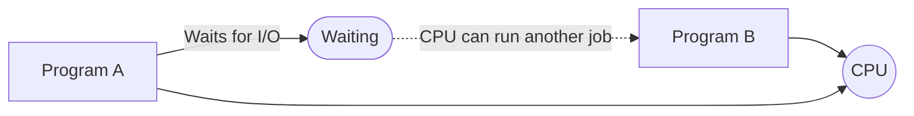

---

## Q6. What is multiprocessing? State its advantages.

### বাংলা ব্যাখ্যা
Multiprocessing system-এ একাধিক CPU বা processing core থাকে। ফলে একাধিক process সত্যিকার অর্থে একই সময়ে আলাদা core-এ চলতে পারে। Multiprogramming-এর মূল উদ্দেশ্য CPU idle না রাখা; multiprocessing-এর মূল সুবিধা হলো একাধিক processor/core দিয়ে কাজ ভাগ করে করা।

### Exam-Ready Answer
**Multiprocessing** is the use of two or more processors or processing cores in one computer system to execute tasks concurrently or in parallel.

**Advantages:**
1. Increases processing speed for suitable workloads.
2. Improves throughput.
3. Allows tasks to run in parallel.
4. Can improve reliability because work may continue if one processor fails, depending on the system design.
5. Shares memory and peripheral devices efficiently in many systems.

**Example:** On a quad-core computer, different processes can run on different cores at the same time.

### Diagram: Multiple cores
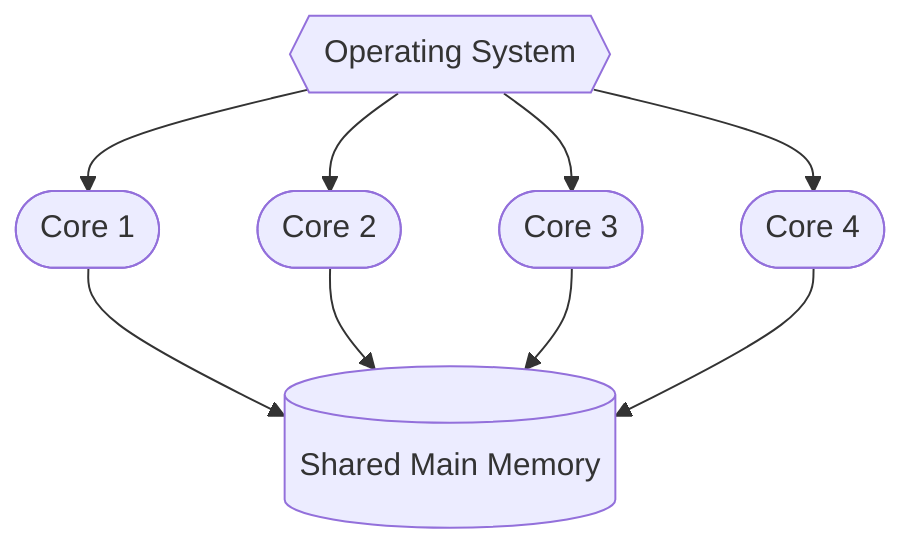

---

## Q7. Differentiate between multiprogramming and multiprocessing.

### বাংলা ব্যাখ্যা
দুটো এক জিনিস নয়। Multiprogramming-এ একাধিক program memory-তে থাকে, আর একটি অপেক্ষা করলে CPU অন্যটি চালায়—সাধারণভাবে একটি CPU-তেও সম্ভব। Multiprocessing-এ একাধিক CPU/core থাকে, তাই একাধিক কাজ একই সময়ে চলতে পারে।

### Exam-Ready Answer

| Multiprogramming | Multiprocessing |
|---|---|
| Several programs are kept in memory. | Two or more processors/cores are available. |
| The main goal is to keep the CPU busy. | The goal includes parallel execution and higher processing capacity. |
| A single CPU can support it by switching between programs. | Uses multiple CPUs or cores. |
| CPU switches to another program when one waits. | Different cores can execute different tasks at the same time. |
| Improves CPU utilization. | Can improve speed and throughput through parallelism. |

**Example:** One CPU switching from a program waiting for disk I/O to another program is multiprogramming. Two CPU cores executing different processes simultaneously is multiprocessing.

---

## Q8. Explain dual-core design.

### বাংলা ব্যাখ্যা
Dual-core processor-এর একটি chip-এর মধ্যে দুটি processing core থাকে। প্রতিটি core নিজের instruction চালাতে পারে। সাধারণত তারা cache বা memory-এর কিছু resource share করতে পারে। তাই এক core একটি কাজ আর অন্য core আরেকটি কাজ চালাতে পারে—যদি OS ও software কাজগুলো ভাগ করতে পারে।

### Exam-Ready Answer
A **dual-core processor** contains two independent processing cores on a single processor chip. Each core can execute instructions, allowing two tasks or threads to run in parallel when supported by the OS and applications.

**Advantages:**
1. Supports parallel execution.
2. Improves multitasking performance.
3. Can provide better performance per watt than simply increasing one core's clock speed.
4. Allows operating systems to schedule work across two cores.

**Limitation:** Performance does not automatically double; it depends on how well the workload can be divided.

### Diagram: Dual-core processor
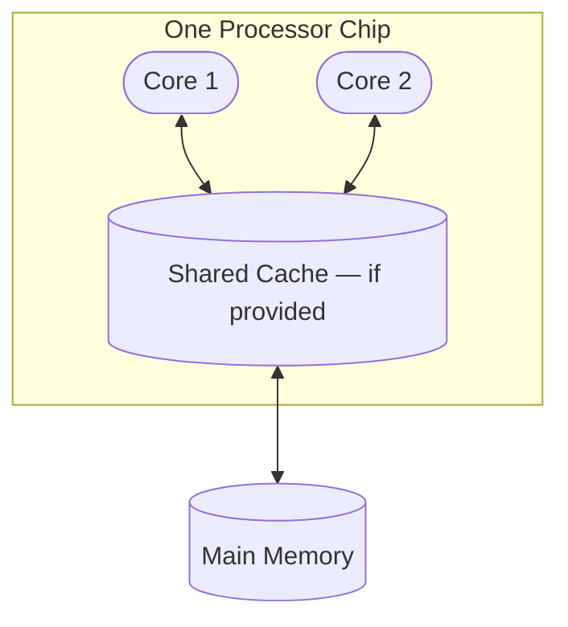

---

## Q9. What is process management? Mention its activities.

### বাংলা ব্যাখ্যা
Program হলো disk-এ থাকা instruction-এর ফাইল; Process হলো সেই program যখন চালু হয়, তখন তার চলমান instance। OS process তৈরি, CPU-তে চালানো, অপেক্ষায় রাখা, process-গুলোর যোগাযোগ ও synchronization এবং কাজ শেষে বন্ধ করার দায়িত্ব নেয়।

### Exam-Ready Answer
**Process management** is the OS function that manages the creation, execution, coordination, and termination of processes.

Its main activities are:
1. Creating and deleting user and system processes.
2. Suspending and resuming processes.
3. Scheduling processes and allocating CPU time.
4. Providing mechanisms for process synchronization.
5. Providing mechanisms for inter-process communication (IPC).
6. Handling deadlocks when required by the system's design.

**Example:** When a user launches a text editor, the OS creates a process, schedules it, and releases its resources when it closes.

---

## Q10. What is storage management? Mention its activities.

### বাংলা ব্যাখ্যা
Storage management বলতে OS-এর file ও storage device পরিচালনা বোঝায়। ফাইল কোথায় থাকবে, কী নামে থাকবে, কে পড়তে বা লিখতে পারবে এবং disk-এর ফাঁকা জায়গা কীভাবে ব্যবহার হবে—এসব OS নিয়ন্ত্রণ করে।

### Exam-Ready Answer
**Storage management** is the OS function that organizes and controls data stored on storage devices.

Its main activities include:
1. **File-system management:** Creates, deletes, reads, and writes files and directories.
2. **Free-space management:** Tracks unused storage space.
3. **Storage allocation:** Decides where files and data blocks are stored.
4. **Disk scheduling:** Organizes disk requests to improve performance where applicable.
5. **Protection and permissions:** Controls access to files and directories.
6. **Mounting and device management:** Makes storage volumes available to the system.

**Example:** When a user saves a document, the OS and file system update the file's data and metadata on storage.

---

## Q11. Explain kernel data structures.

### বাংলা ব্যাখ্যা
Kernel হলো OS-এর core অংশ। Kernel-কে process, memory, file এবং device সম্পর্কে অনেক তথ্য রাখতে হয়। সেই তথ্যগুলো সাজিয়ে রাখার জন্য data structure ব্যবহার করা হয়—যেমন linked list, queue, tree, hash table ও bitmap। এগুলো তথ্য খুঁজতে এবং resource পরিচালনা করতে সাহায্য করে।

### Exam-Ready Answer
**Kernel data structures** are organized ways of storing information that the operating-system kernel needs to manage processes, memory, files, and devices.

Common examples are:
- **Lists:** Store collections of related items, such as processes.
- **Queues:** Manage items waiting for service, such as ready or I/O queues.
- **Trees:** Represent hierarchical information, such as directory structures.
- **Hash tables:** Help find information quickly using keys.
- **Bitmaps:** Track the status of resources, such as free or used memory blocks.

These structures help the kernel organize information and perform operating-system operations efficiently.

### Diagram: Data structure examples
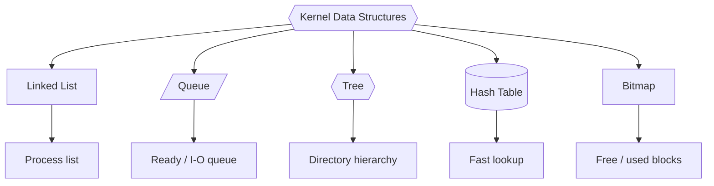

---

## Q12. Explain the process state diagram.

### বাংলা ব্যাখ্যা
Process চলার সময় কয়েকটি state-এর মধ্যে যায়। **New** মানে তৈরি হচ্ছে, **Ready** মানে CPU পাওয়ার অপেক্ষায়, **Running** মানে CPU-তে চলছে, **Waiting/Blocked** মানে I/O বা কোনো event-এর অপেক্ষায়, আর **Terminated** মানে শেষ। CPU বরাদ্দ, I/O request বা I/O completion হলে state বদলায়।

### Exam-Ready Answer
A **process state** represents the current condition of a process. The common five states are:

1. **New:** The process is being created.
2. **Ready:** The process is waiting to be assigned to the CPU.
3. **Running:** The CPU is executing the process.
4. **Waiting/Blocked:** The process is waiting for an I/O operation or another event.
5. **Terminated:** The process has finished execution.

### Diagram: Standard five-state process model
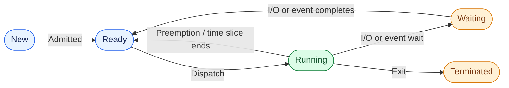

**Remember:** Ready means waiting for the CPU; Waiting means waiting for an event or I/O.

---

## Q13. What is a Process Control Block (PCB)?

### বাংলা ব্যাখ্যা
PCB হলো প্রতিটি process-এর জন্য OS-এর রাখা একটি record বা তথ্যের খাতা। এতে process ID, state, program counter, CPU registers, scheduling information, memory information এবং I/O status থাকে। CPU এক process থেকে অন্য process-এ গেলে OS PCB ব্যবহার করে আগের process-এর অবস্থা সংরক্ষণ ও পরে ফিরিয়ে আনে।

### Exam-Ready Answer
A **Process Control Block (PCB)** is a data structure maintained by the operating system to store information about a process.

A PCB commonly contains:
1. **Process ID (PID):** Unique process identifier.
2. **Process state:** New, ready, running, waiting, or terminated.
3. **Program counter:** Address of the next instruction to execute.
4. **CPU registers:** Saved register values.
5. **CPU-scheduling information:** Priority and scheduling-related data.
6. **Memory-management information:** Memory mappings or allocation details.
7. **I/O status information:** Open files and assigned devices.

The PCB helps the OS manage processes and perform context switching.

### Diagram: PCB contents
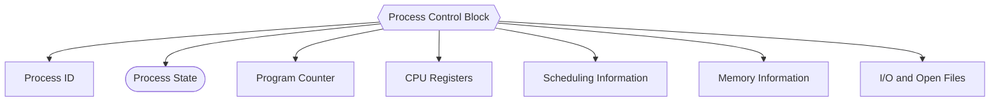

---

## Q14. What is multitasking?

### বাংলা ব্যাখ্যা
Multitasking-এ ব্যবহারকারী একসঙ্গে অনেক কাজ করছে বলে মনে হয়—যেমন গান শোনা, browser ব্যবহার এবং document লেখা। OS খুব দ্রুত task-গুলোর মধ্যে CPU time ভাগ করে। একটি single CPU core-এ সাধারণত এক মুহূর্তে একটি thread চলে, কিন্তু দ্রুত switching-এর কারণে সব কাজ একসঙ্গে চলছে বলে মনে হয়। Multi-core হলে কিছু কাজ সত্যিই parallel-এ চলতে পারে।

### Exam-Ready Answer
**Multitasking** is the ability of an operating system to run multiple tasks seemingly at the same time by sharing CPU time among them.

The OS uses CPU scheduling and context switching to move between tasks. On a single core, tasks usually take turns; on a multicore system, some tasks can run in parallel.

**Advantages:**
1. Allows users to work with several applications.
2. Improves responsiveness.
3. Uses CPU time efficiently.
4. Supports interactive computing.

**Example:** A user can listen to music while browsing the web and editing a document.

### Diagram: CPU time sharing
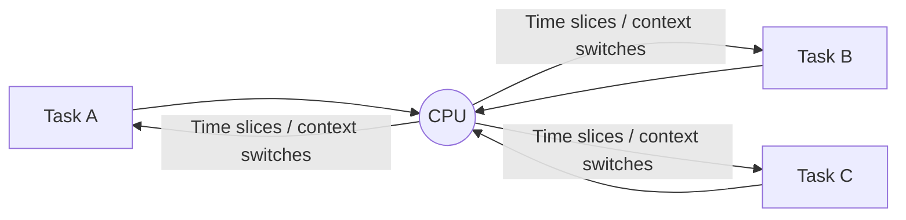

---

## Q15. What is a thread? Explain its types or benefits.

### বাংলা ব্যাখ্যা
Thread হলো process-এর ভেতরের execution-এর একটি ছোট unit। একই process-এর একাধিক thread code, data এবং open files-এর মতো resource share করতে পারে, কিন্তু প্রত্যেক thread-এর নিজের stack, registers ও execution state থাকে। যেমন browser-এর একটি thread UI চালাতে পারে, আরেকটি background কাজ করতে পারে।

### Exam-Ready Answer
A **thread** is the smallest unit of CPU execution within a process. A process can contain one or more threads.

Threads in the same process share code, data, and many process resources, but each thread has its own program counter, register state, and stack.

**Benefits of threads:**
1. **Responsiveness:** One thread can continue while another waits.
2. **Resource sharing:** Threads share the process's resources.
3. **Economy:** Creating and switching between threads can be less costly than processes, depending on the system.
4. **Parallelism:** Threads can run on multiple CPU cores.

**Types (common textbook classification):**
- **User-level threads:** Managed by a user-space thread library.
- **Kernel-level threads:** Managed and scheduled by the operating system kernel.

### Diagram: One process, multiple threads
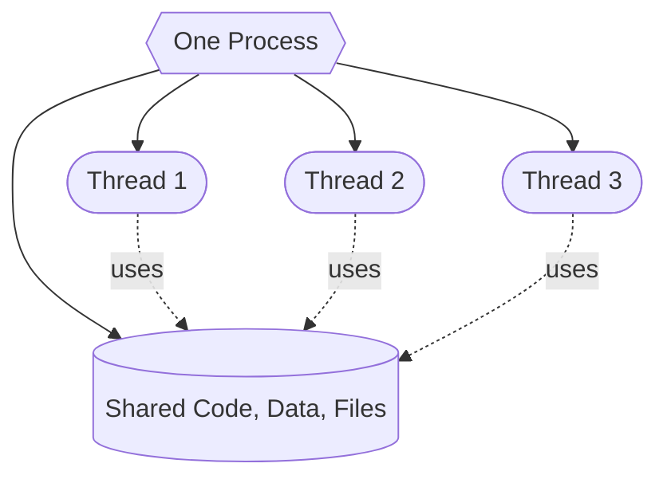

---

## Q16. Explain process scheduling and scheduling queues.

### বাংলা ব্যাখ্যা
Ready queue-তে সেই process-গুলো থাকে যারা CPU চালানোর জন্য প্রস্তুত। CPU busy থাকলে তারা অপেক্ষা করে। কোনো process I/O চাইলে সেটি device queue-তে যায়। I/O শেষ হলে আবার ready queue-তে ফিরে আসে। Queue হলো অপেক্ষার জায়গা, আর CPU/I/O device হলো কাজ করে দেওয়ার resource।

### Exam-Ready Answer
**Process scheduling** is the OS activity of selecting a ready process for CPU execution.

Common scheduling queues are:
1. **Job queue:** All processes in the system.
2. **Ready queue:** Processes in main memory that are ready and waiting for CPU time.
3. **Device queues:** Processes waiting for a particular I/O device or event.

A process moves between these queues during its lifetime. When I/O completes, a waiting process usually returns to the ready queue.

### Diagram: Scheduling queues (queues are boxes; service resources are circles)
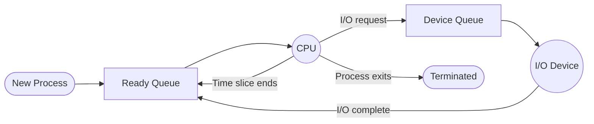

---

## Q17. Explain the different types of schedulers.

### বাংলা ব্যাখ্যা
Scheduler তিন ধরনের হতে পারে। Long-term scheduler ঠিক করে কোন job system-এ ঢুকবে। Short-term scheduler ready queue থেকে পরের কোন process CPU পাবে তা বেছে নেয়। Medium-term scheduler প্রয়োজনে process-কে সাময়িকভাবে RAM থেকে সরিয়ে পরে ফিরিয়ে আনতে সাহায্য করে (swapping)।

### Exam-Ready Answer
An **OS scheduler** selects processes for different stages of execution. The three common types are:

1. **Long-term scheduler (job scheduler):** Selects jobs from secondary storage and admits them into memory. It controls the degree of multiprogramming.
2. **Short-term scheduler (CPU scheduler):** Selects a process from the ready queue and assigns the CPU to it. It runs frequently.
3. **Medium-term scheduler:** Temporarily removes processes from memory and later brings them back, helping manage memory and the number of active processes.

### Diagram: Scheduler roles
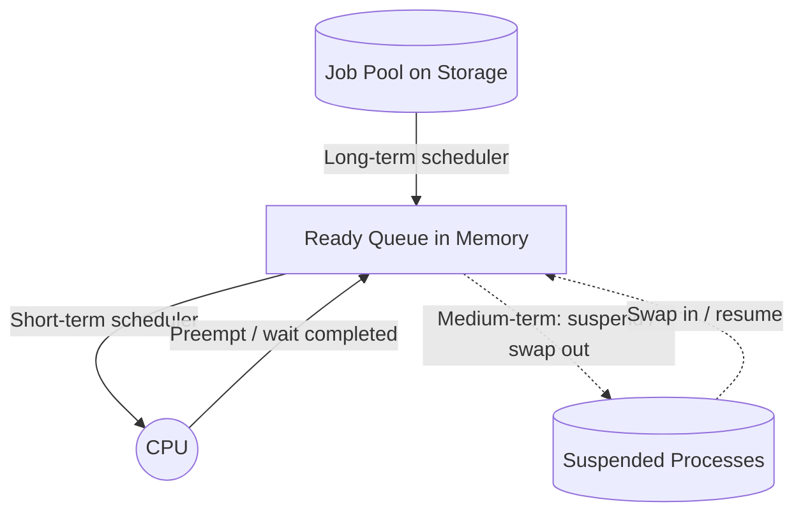

---

## Q18. Explain Google Chrome's multiprocess architecture.

### বাংলা ব্যাখ্যা
Chrome browser-কে স্থিতিশীল ও নিরাপদ রাখতে কাজগুলো আলাদা process-এ ভাগ করে। Browser process address bar, tabs ও browser UI পরিচালনা করে। Renderer process webpage দেখায় এবং তার HTML/CSS/JavaScript চালায়। GPU process graphics-related কাজ করে; আরও utility process থাকতে পারে। ফলে একটি tab-এর renderer crash করলে পুরো browser সবসময় crash করে না, আর process isolation নিরাপত্তায় সাহায্য করে। বাস্তব Chrome-এর architecture সংস্করণ ও settings অনুযায়ী আরও জটিল হতে পারে।

### Exam-Ready Answer
Google Chrome uses a **multiprocess architecture**, separating major browser functions into different processes.

- **Browser process:** Manages browser UI, tabs, navigation, and privileged operations such as network and file access.
- **Renderer process:** Processes webpage content and renders a site or page.
- **GPU process:** Handles graphics-related work.
- **Utility processes:** Handle supporting tasks such as network or other services.

**Advantages:**
1. Better isolation between webpages and browser components.
2. A renderer crash may be limited to the affected page or process.
3. Can improve security by restricting renderer access.
4. Different tasks can be managed independently.

### Diagram: Simplified Chrome architecture
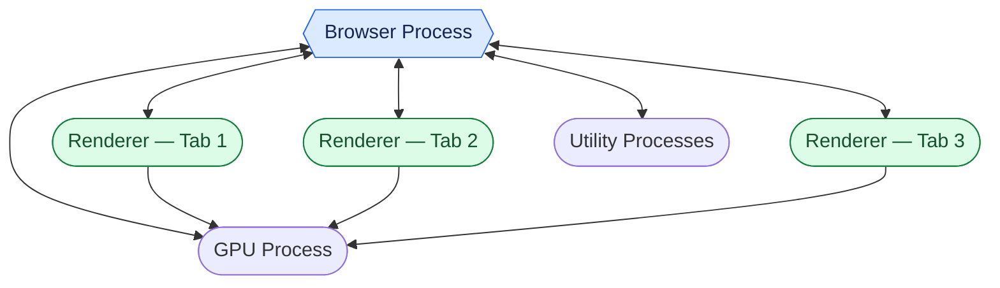

---

## Q19. What is message passing?

### বাংলা ব্যাখ্যা
Process-গুলো একে অপরের memory সরাসরি share না করেও message পাঠিয়ে যোগাযোগ করতে পারে। একটি process message send করে, অন্যটি receive করে। OS-এর IPC mechanism message আদান-প্রদান ও coordination-এর ব্যবস্থা করে। Network communication বা client-server program-এ এ ধরনের ধারণা কাজে লাগে।

### Exam-Ready Answer
**Message passing** is an inter-process communication (IPC) method in which processes exchange data by sending and receiving messages instead of directly sharing memory.

The two basic operations are:
- **send(message):** Sends a message to another process or communication endpoint.
- **receive(message):** Receives a message from another process or endpoint.

Communication may be direct between processes or indirect through a mailbox or message queue. It can be blocking or non-blocking, depending on the system.

**Advantages:** It supports communication and coordination and can provide isolation between processes.

**Example:** A client process sends a request message to a server process and receives a reply.

### Diagram: Message passing
```mermaid
flowchart LR
    A([Process A]) -->|send(message)| Q[(Mailbox / Message Queue)]
    Q -->|receive(message)| B([Process B])
    B -->|reply| Q
    Q --> A
```

---

## Q20. What is process synchronization? Why is it needed?

### বাংলা ব্যাখ্যা
একাধিক process বা thread একই shared data ব্যবহার করলে একসঙ্গে পরিবর্তনের কারণে ভুল result হতে পারে। যেমন দুইটি thread একই bank balance পড়ছে এবং আলাদা আলাদা update করছে। Synchronization তাদের critical section-এ নিয়ন্ত্রিতভাবে ঢুকতে দেয়। Mutex, semaphore এবং monitor হলো পরিচিত synchronization tool।

### Exam-Ready Answer
**Process synchronization** is the coordination of processes or threads that share data or resources, so their operations occur safely and in the required order.

It is needed to:
1. Prevent race conditions.
2. Protect shared data.
3. Ensure mutual exclusion in critical sections.
4. Coordinate tasks that depend on each other's results.

Common synchronization tools include **mutex locks, semaphores, and monitors**.

A **critical section** is the part of a program that accesses shared data or resources. A correct solution aims to ensure mutual exclusion, progress, and bounded waiting where applicable.

### Diagram: Critical-section idea
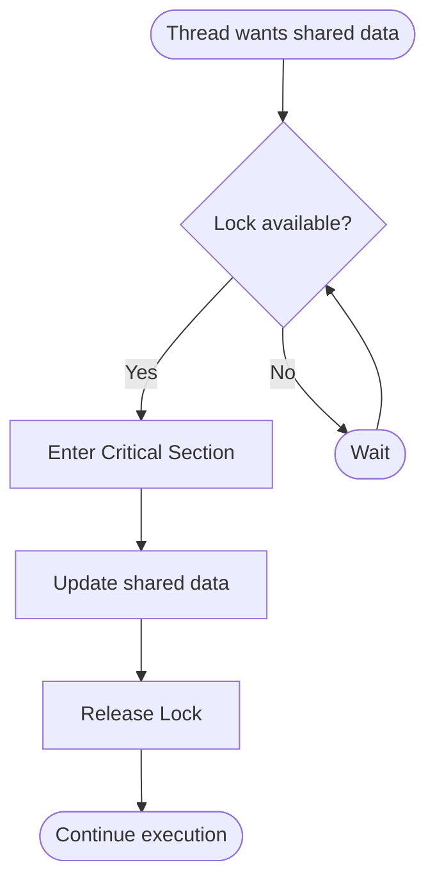

---

## Q21. What is a socket?

### বাংলা ব্যাখ্যা
Socket হলো network communication-এর একটি endpoint। সাধারণভাবে client socket-এর মাধ্যমে server-এর socket-এ request পাঠায়, server response দেয়। IP address machine/network interface চিহ্নিত করতে সাহায্য করে, আর port number নির্দিষ্ট application/service-এ পৌঁছাতে সাহায্য করে। TCP socket সাধারণত connection-oriented; UDP socket datagram পাঠায়।

### Exam-Ready Answer
A **socket** is a communication endpoint used by processes to exchange data, commonly over a network.

A network endpoint is commonly identified by an IP address and a port number, together with the transport protocol.

**Common types:**
- **TCP socket:** Uses a connection-oriented, reliable byte stream.
- **UDP socket:** Sends datagrams without establishing a connection and does not guarantee delivery.

Sockets are widely used in client-server applications.

**Example:** A web browser uses network sockets to communicate with a web server.

### Diagram: Client-server socket communication


---

## Q22. Differentiate between a process and a thread.

### বাংলা ব্যাখ্যা
Process হলো চলমান program-এর instance এবং এর নিজস্ব address space/resources থাকে। Thread হলো process-এর ভেতরে execution-এর unit। একই process-এর thread-গুলো code/data share করে, কিন্তু আলাদা stack ও register state রাখে। তাই thread সাধারণত হালকা, কিন্তু shared data নিয়ে synchronization-এর প্রয়োজন হতে পারে।

### Exam-Ready Answer

| Process | Thread |
|---|---|
| A process is a program in execution. | A thread is an execution unit within a process. |
| Has its own process address space. | Shares the process address space with other threads in that process. |
| Usually has its own process resources and control information. | Has its own stack, registers, and execution state. |
| Process creation and switching are generally more expensive. | Thread creation and switching are often less expensive. |
| Communication may require IPC. | Threads can communicate through shared process data. |
| Stronger isolation between processes. | A faulty thread can affect other threads in the same process. |

**Example:** Two separate browser applications are different processes. Multiple threads inside one browser process may handle user-interface work and background tasks.

### Diagram: Process versus threads
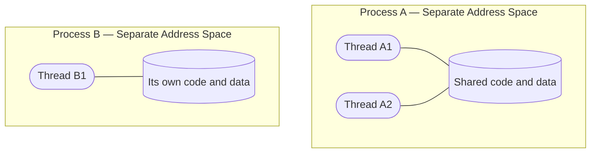

---

# Quick Revision — One-line memory cues

| Topic | Remember this |
|---|---|
| Operating System | Manages hardware and software resources |
| Interrupt | Temporarily redirects the CPU to handle an event |
| Memory management | Tracks, allocates, and protects RAM |
| System architecture | CPU + memory + I/O + interconnect |
| Multiprogramming | Keep multiple programs in memory; run another when one waits |
| Multiprocessing | Use multiple processors/cores |
| Dual-core | Two cores on one processor chip |
| Process management | Create, schedule, synchronize, and terminate processes |
| Storage management | Manage files, disks, free space, and access |
| Kernel data structures | Lists, queues, trees, hash tables, bitmaps |
| Ready state | Waiting for CPU |
| Waiting state | Waiting for I/O/event |
| PCB | The OS record containing process information |
| Multitasking | Share CPU time among tasks |
| Thread | Unit of execution within a process |
| Scheduling queues | Ready queue and device queues |
| Schedulers | Long-term, short-term, medium-term |
| Chrome multiprocess | Browser, renderer, GPU, utility processes |
| Message passing | Processes communicate using send/receive messages |
| Synchronization | Coordinate shared-resource access |
| Socket | Network communication endpoint |
| Process vs thread | Separate address space vs shared process resources |

---

# Important full forms

- **OS** — Operating System
- **CPU** — Central Processing Unit
- **RAM** — Random Access Memory
- **I/O** — Input/Output
- **PCB** — Process Control Block
- **PID** — Process Identifier
- **ISR** — Interrupt Service Routine
- **IPC** — Inter-Process Communication
- **GPU** — Graphics Processing Unit
- **TCP** — Transmission Control Protocol
- **UDP** — User Datagram Protocol

---

# How to write a 5-mark answer

1. Start with a clear **definition**.
2. Write **4–6 short points** that answer the question directly.
3. Add one small, relevant example if useful.
4. Draw a diagram only when it helps explain the concept. Label the arrows and shapes.
5. Keep the English simple and readable; avoid unrelated details.

## Diagram note
The diagrams in this file are simplified study diagrams, not exact screenshots from a textbook. The process-state diagram uses state-shaped nodes and labelled transitions; scheduling diagrams use boxes for queues and circles for service resources; the Chrome diagram shows the main process roles. These are based on standard OS teaching models.

## References for diagram conventions and concepts
- [Operating System — Process Concepts and Scheduling Queues (INFLIBNET)](https://ebooks.inflibnet.ac.in/csp3/chapter/process-concepts/)
- [OpenStax — Computer Systems Organization](https://openstax.org/books/introduction-computer-science/pages/5-1-computer-systems-organization)
- [OpenStax — Memory Hierarchy](https://openstax.org/books/introduction-computer-science/pages/5-5-memory-hierarchy)
- [Chrome for Developers — Inside look at modern web browser](https://developer.chrome.com/blog/inside-browser-part1)
- [Chromium — Multi-process Architecture](https://www.chromium.org/developers/design-documents/multi-process-architecture/)
